# AgentDeck

**在浏览器里远程驾驭 Claude Code / opencode / MiniMax Code / Qoder / Codex。单文件 Go 二进制，前端内嵌，开箱即用。**

> **v0.5.0 · Personal Agent 正式发布**：一个主 Agent 带多个 worker，五个 CLI 可以混用；主 Agent 与 worker 通过引擎中立的 A2A 总线互相派工、回报和记账，全部收口在一个 Web 控制台里。

AgentDeck 是五个编码 CLI 的统一 Web 控制台。它把会话管理、流式对话、工具调用可视化、回滚、群聊编排和移动化体验整合到一个轻量级服务里——你只需把它跑在远程机器上，手机或电脑打开浏览器即可开始工作。

> 项目内部标识仍是 `cc-webui`（Go module、二进制、`CC_WEBUI_*` 环境变量、`ccgw_token` Cookie、`~/.config/cc-webui`），只有展示名换成了 AgentDeck。

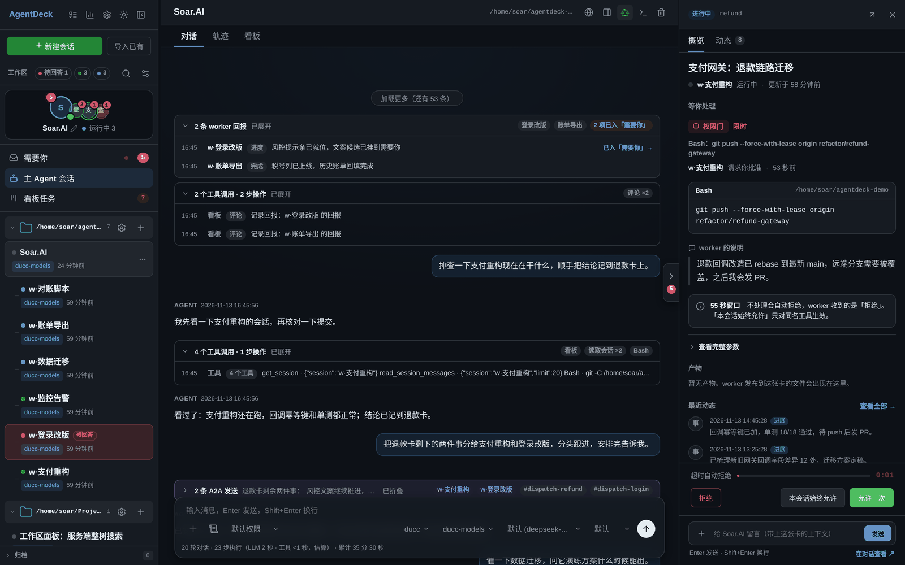

*Personal Agent 工作台：左栏是主 Agent 与运行中的 worker；中栏是主 Agent 会话，worker 回报和看板操作按轮折叠；右栏是卡片详情——权限门、提问、验收都能就地处理。*

---

## 为什么需要 AgentDeck

- **远程开发**：Claude Code 运行在服务器 / 跳板机 / 容器里，本地不想反复 SSH。
- **多会话并行**：同时为多个项目维护独立会话，随时切换、归档、恢复。
- **模型与后端自由切换**：同一会话可在不同 API 后端或模型之间热切换，不丢失上下文。
- **工具调用可视化**：命令、文件读写、编辑 diff、todo 列表、本地文件链接都以卡片形式呈现，不用在终端里翻找。
- **移动端可用**：PWA 式体验，抽屉导航、底部操作面板、触屏优化，外出时也能跟进会话。

---

## Personal Agent：一个主 Agent 带多个 worker

这是 v0.5.0 的主线能力。打开「设置 → 界面形态 → Personal Agent」，控制台会从会话瀑布流切换成三栏：

- **左栏**：主 Agent 头像 + 运行中的 worker 叠放；三个入口——「需要你队列」「主 Agent 会话」「看板任务」。看板只属于主 Agent，进入 worker 会话时会自动收起。
- **中栏**：
  - **需要你队列**：把权限门、AskUserQuestion、看板「待人工 / 待验收」合并成一条按紧急度排序的队列；55 秒窗口的门显示倒计时，超时或已处理会生成如实回执，不假装成功。
  - **主 Agent 会话**：复用原对话流；连续 worker 回报/系统通知按人类轮次折叠成「N 条 worker 回报 · M 条系统通知」，主 Agent 自己的 board 工具调用单独折叠成「N 次看板操作」；人类消息和主 Agent 最终回复不折。回报组默认展开，组内工具细节仍可折叠。
  - **看板任务**：按状态分列，点卡片打开右栏详情。
- **右栏**：卡片优先详情（概览 / 动态 / 产物 / 等你处理），底部常驻 composer；关闭后完全收起，用右侧手柄或「给 mainAgent 留言」重新打开。「动态」复用看板时间线样式与「全部 / 事件 / 消息 / A2A / 工具」筛选，长文本可展开。
- **作答**：权限/提问直达 worker；拍板/验收先送达 worker，再记时间线和更新看板，失败保留条目可重试；A2A 使用操作级幂等键，不会因重试吞掉第二次决定。
- **真实数据**：`/api/needs-you`、`/api/agent-board(+events)`、`/api/sessions/{id}/permissions/pending`、`/api/a2a/send`、`/api/agent-board/tasks/{id}/events` 等，没有前端 mock。

**需要你队列与权限审批**

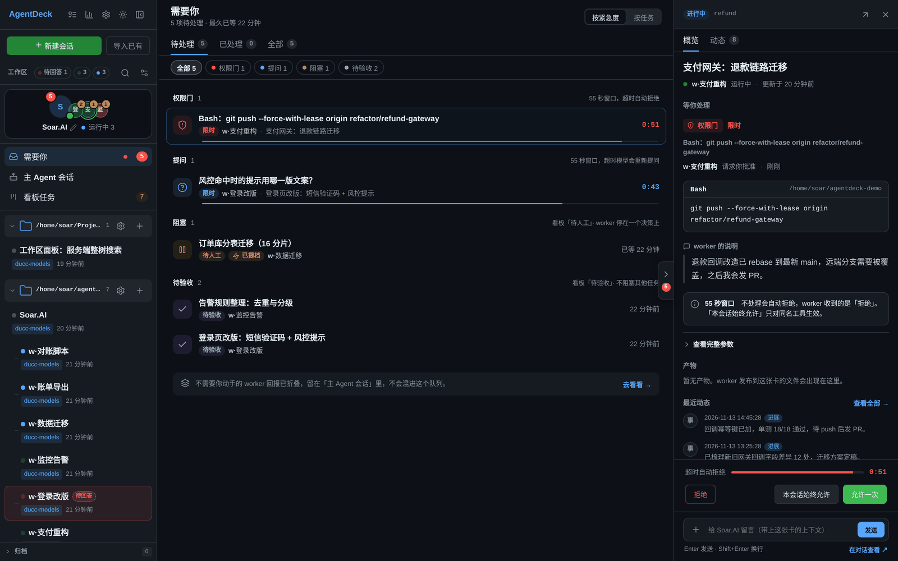

*权限门、提问、待人工、待验收合成一条按紧急度排序的队列；右栏直接允许本次 / 本会话允许 / 拒绝，倒计时和超时回执都是真实状态。*

**看板任务与卡片详情**

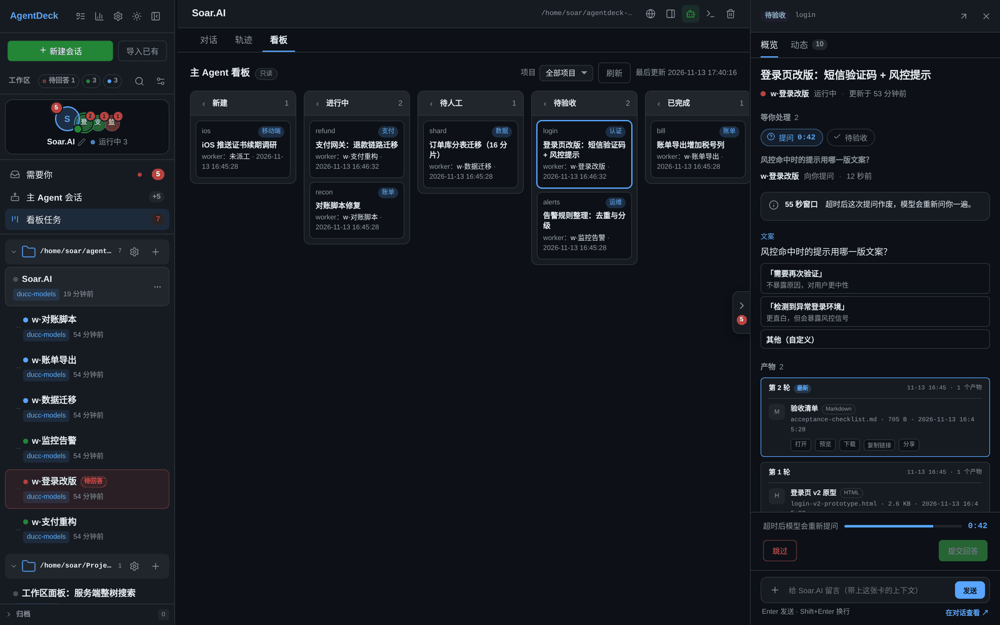

*看板按状态分列；点开卡片在右栏看概览、动态和产物，验收 / 打回也都落在这张卡上。*

设计细节见 [AGENTS.md §17](AGENTS.md) 与 [docs/needs-you-rd.md](docs/needs-you-rd.md)。

## 多 CLI 与跨引擎 A2A

AgentDeck 的五个引擎（claude / opencode / mcode / qoder / codex）不是五个孤岛：

- **主 Agent 和 worker 可以是不同引擎**。例如主 Agent 用 ducc，支付 worker 用 opencode，迁移 worker 用 codex；看板、A2A 回报和「需要你」队列在同一个控制台里。
- **地址名引擎无关**。每个会话可以设置 `peer_name`，A2A 投递按精确 session id 或地址名解析；同名时有消歧规则。
- **总线不需要接收方常驻**。`POST /api/a2a/send` 把消息排成目标会话的一轮（和用户发消息同一条 `Enqueue` 路径），一次性进程、共享 serve、常驻进程都能收。入站落成一条 `source:"a2a"` 的 user 事件，前端渲染成 A2A 气泡，回放与实况一致，不需要为每个引擎单独写 reader。
- **所有引擎都注入 agentdeck MCP**：会话管理（`list_sessions` / `new_session` / `get_session` / `stop_session`）、A2A（`send_message`，支持 `send_id` 幂等）、读/搜（`read_session_messages` / `search_messages`）和主 Agent 的看板工具（`board_*`）。
- **运行时通知也走 A2A**：worker 异常结束、卡住、停在人工门时，runtime 会向主 Agent 发通知；主 Agent 据此记账或在看板置「待人工」。

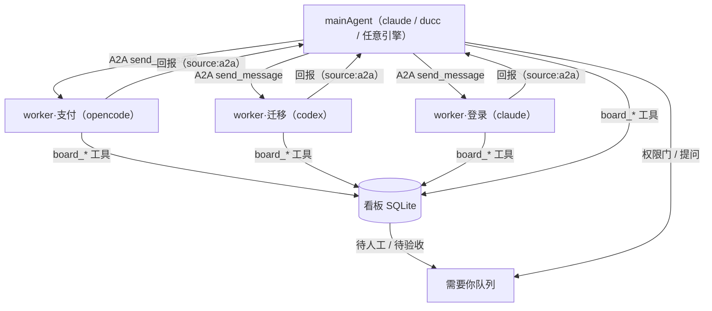

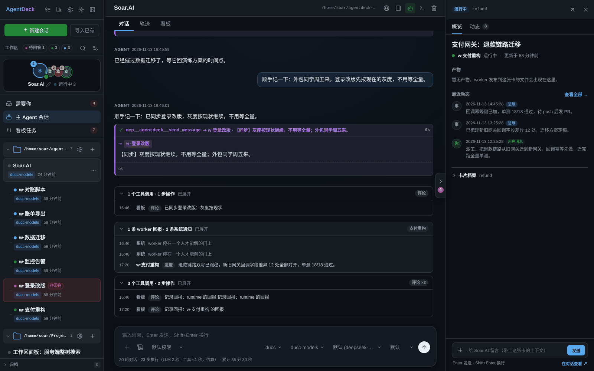

*主 Agent 会话：连续 worker 回报按轮折叠；`send_message` 的派工卡片与 worker 的 peer 气泡同屏出现，不需要轮询或共享剪贴板。*

详见 [a2a-rd.md](a2a-rd.md)、[docs/main-agent-best-practices.md](docs/main-agent-best-practices.md) 和 [AGENTS.md §17](AGENTS.md)。

## 核心特性

| 特性 | 说明 |
|---|---|
| 单二进制部署 | `go build` 生成一个可执行文件，前端资源已用 `go:embed` 打包，无需 Node 构建。 |
| 五引擎 | cli/provider 的 `kind` 选 `claude`（缺省）、`opencode`、`mcode`、`qoder` 或 `codex`，同一套界面里管理不同引擎的会话。会话绑定单一引擎，创建/修改/导入时 cli 与 provider 的 kind 必须一致。 |
| 多 CLI / Provider / Model | 配置文件定义多个 CLI 与 API 后端；会话内一键热切换 CLI、Provider、Model、权限模式与推理档位（opencode 的对应概念是 variant）。opencode / mcode / qoder / codex 的模型清单由各自 CLI 动态提供，写死会过期；opencode 里登录的 provider 还会被自动发现，一般不用在配置里手写。 |
| Personal Agent | 设置 → 界面形态切到 Personal Agent：左栏主 Agent 头像 + worker，中栏需要你队列 / 主 Agent 会话 / 任务看板，右栏卡片优先详情与常驻 composer。权限门 / 提问 / 待人工 / 待验收统一成队列，worker 回报与看板工具调用自动折叠。 |
| 多 CLI 协作与 A2A | 五个引擎都能当主 Agent 或 worker，可以混用；`POST /api/a2a/send` 引擎中立，接收方不需要常驻。agentdeck MCP 给所有引擎注入 `send_message`、`new_session`、`read_session_messages`、`search_messages` 与看板工具；A2A 在对话流和轨迹里归入 A2A 角色。 |
| 导入已有会话 | 扫描各引擎自己的历史目录（`~/.claude/projects`、`~/.qoder-cn/projects`、opencode / mcode 的会话库、codex 的 rollout 目录），把本地历史会话一键接进 Web UI 继续聊。 |
| 回滚（rewind） | 每条带文件 checkpoint 的用户消息可 ⏪ 回滚。claude：CLI 恢复 Write/Edit 改过的文件、删除期间新建的文件，对话与 transcript 一并截断，消息文本回填输入框。opencode：走它自己的 revert 快照（stage + commit），对话由 opencode 的存储回滚。Bash 改的文件不在 checkpoint 内。其余引擎隐藏入口。 |
| 流式实时对话 | SSE 推送，Markdown 渲染、代码高亮、工具调用折叠块、token 与花费统计、排队与停止。CLI 开启 `partial_messages` 后支持打字机式逐 token 增量渲染（claude 的 `--include-partial-messages`，opencode 走 `message.part.delta`）。会话信息条显示轮数、步数、累计耗时与最近一轮 tok/s。 |
| 权限审批卡 | 非 bypass 的 claude/qoder 会话在工具调用前弹审批卡：允许本次 / 本次会话都允许（同名工具）/ 拒绝（可附理由），55s 超时自动拒绝。经 `--settings` 的 `PermissionRequest` hook 实现。opencode 的 `permission.asked` 与 `question.asked` 也映射到同一张卡；mcode（`--permission full/smart`）与 codex（沙箱模式）没有审批面。 |
| 提问强提示 | 模型提问（AskUserQuestion / opencode question）有 55s 硬超时，而卡片只停在当前会话。所以提问时另有顶部居中横幅、侧栏整行脉动、工作区栏「待回答 N」徽标——跨会话也能看见，点一下直达那张卡。 |
| 多 agent 群聊 | 一个群拉多个成员（各引擎通用），`@成员` 定向、`@all`/空群发并行跑；成员是隐藏影子会话（点名直接打开看单独回放），群有独立 transcript 与时间线，审批卡照常弹。 |
| 常驻与跨会话消息 | A2A 总线对所有引擎可用；claude 还可选择常驻（streaming-input 进程跨轮次保持在线）并兼容 claude 原生 `SendMessage`。入站 A2A 以紫色 peer 气泡显示，详情见下方「多 CLI 与跨引擎 A2A」。 |
| 自动续跑目标 | 给会话挂一条达成条件，每轮干净结束后模型自评，未达标就自动再跑一轮，直到达标或触发轮数/时限熔断。条件可随时停止或清除；rewind 会清空目标。 |
| 工具调用可视化 | Bash 终端视图、Read/Write/Edit diff、TodoWrite 检查清单、thinking 折叠块、子代理折叠卡片。 |
| HTML / Mermaid 可视化 | 模型输出的 `html` 围栏可在消息里点「渲染」成沙箱 iframe——完整页面、图表、交互都行；`mermaid` 围栏可点「渲染」画成图，并跟随深浅主题切换。iframe 不给 `allow-same-origin`，页面完全自包含。服务端每轮向模型注入「把可视化输出成 HTML 围栏而不是写文件」的约定（config 里可关）。 |
| 会话分叉 | claude / qoder 可把当前 transcript 复制成新会话，从同一上下文另开一条分支（不动原会话）。 |
| 轨迹视图 | 会话内「轨迹」tab 把同一份事件流投影成按轮(turn)分组的台账：折叠/展开轮次、按角色（用户/助手/工具）筛选、关键词搜索，点开单条记录看 summary / preview / raw 三档详情。对话流之外的另一种审阅视角。 |
| 使用统计 | 统计本机全部会话（Claude Code、opencode、mcode、qoder、codex 五个引擎合并计数，页面上标出各自贡献的会话数）：8 个指标（会话/消息/总 tokens/活跃天数/当前连续/最长连续/峰值时段/常用模型）+ GitHub 式热力图，按日按模型看 tokens 构成。opencode 走它的 CLI 官方面（`session list` 只看得见当前目录所属的项目桶，故枚举全部项目额外走一条只读 `opencode db` 查询，实测只读不写，失败自动退回按桶列举）；mcode 读它自己的 `messages.jsonl` transcript（mcode 没有 `session list`/`export` 这类 CLI 面）；qoder 与 Claude Code 同构，读 `~/.qoder-cn/projects` 的 jsonl；codex 读 `$CODEX_HOME/sessions` 的 rollout（ducx 为 `~/.baidu-cx`）。增量缓存——首次全量扫描较慢，之后秒回。注意 qoder 的 `usage` 不上报 token 数（计费走 `credits`），所以对 qoder 会话而言消息数/工具数/活跃天数都准，token 类指标对它无意义。 |
| 本地文件与图片预览 | 点击消息中的本地文件链接（如 `/path/to/file.md:12`）**直接开右侧工作区面板**预览该文件并定位到那一行（工作区外的文件退回旧的预览浮层）。模型回复里 `` 这类本地图片经 `/api/image` 代理显示，同样限制在会话工作区内。 |
| 工作区面板 | 聊天区右侧可展开一个文件区（照 Codex 桌面端的布局做）：右边是工作区文件树（懒加载、可筛选、可只看有改动的文件），左边是文件预览——Markdown 渲染、代码高亮、图片直看，带面包屑与「显示更改 / 查看源代码 / 刷新 / 用系统默认程序打开」。改动视图走 `git diff`，被改过的文件在树上带 M/新 标记。全部路径严格限制在**当前会话的工作区**内，`..`、绝对路径与符号链接逃逸一律拒绝。 |
| 全局待办备忘 | 与单个会话无关的 checklist，存在服务端 `data/notes.json`，换设备/重启都不丢。 |
| 任务完成通知 | 任务跑完（或出错）时弹系统横幅通知 + 播放提示音，点击通知直达对应会话。侧边栏「设置」里可分别开关，配置存 localStorage 跟着浏览器走，不同终端各自配置。 |
| TUI 与 Web 自由切换 | 每个会话都有 session id，点「resume」复制命令即可回到 TUI 继续跟进，Web 里做的一切状态都在。claude/qoder 的命令带 `--model`/档位，provider env 非空时再带一个物化好的 `--settings`；opencode 是 `-s <sid>`，mcode 是 `--session <mvs_…>`，codex 是 `resume <sid>` 带模型/档位/沙箱。 |
| 移动优先 PWA | 抽屉导航、底部操作面板、响应式布局、深浅主题切换，iOS 独立 PWA 会避开状态栏安全区。 |
| 安全网关 | 单一 `gateway_token` 鉴权；文件与图片预览严格限制在会话工作区内。 |

## 界面一览

<table>
  <tr>
    <td width="50%">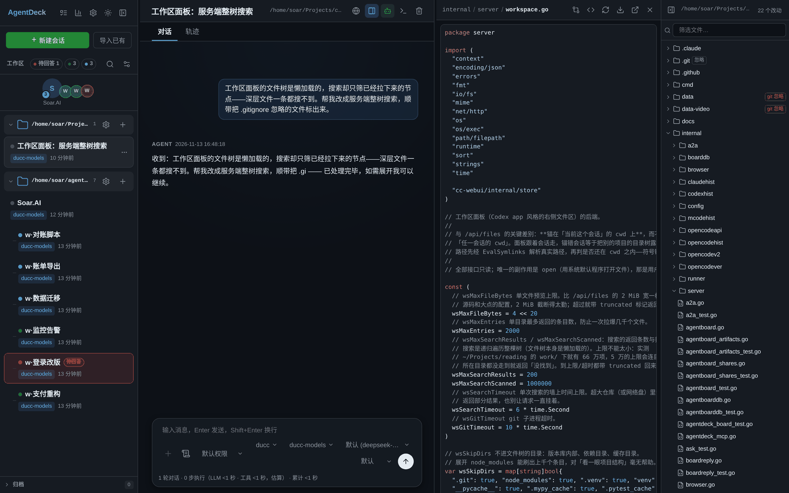</td>
    <td width="50%">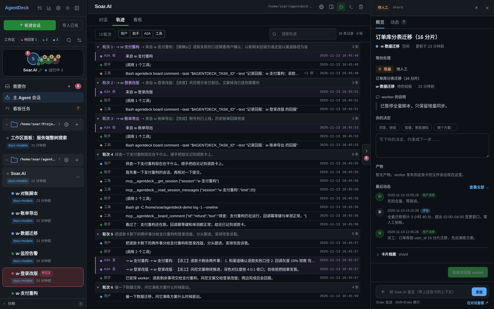</td>
  </tr>
  <tr>
    <td align="center"><sub>工作区面板：文件树 + 预览 + git 状态，路径锁定在当前会话 cwd</sub></td>
    <td align="center"><sub>轨迹视图：同一份事件流按轮投影成台账，可按角色筛选、搜索</sub></td>
  </tr>
  <tr>
    <td>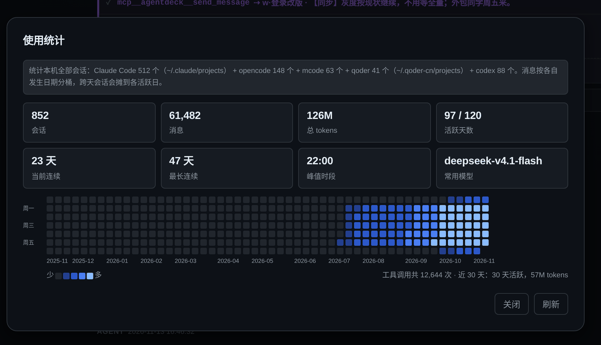</td>
    <td align="center">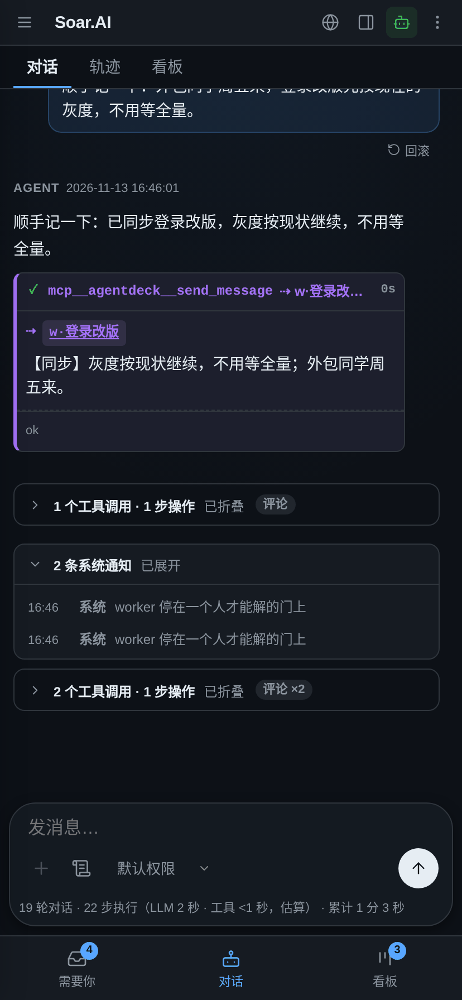</td>
  </tr>
  <tr>
    <td align="center"><sub>使用统计：五引擎合并计数 + GitHub 式热力图（演示数据）</sub></td>
    <td align="center"><sub>移动端：响应式布局 + 底部「需要你 / 对话 / 看板」切换</sub></td>
  </tr>
  <tr>
    <td>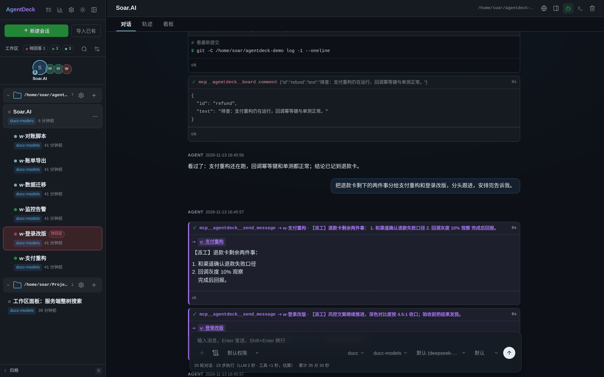</td>
    <td>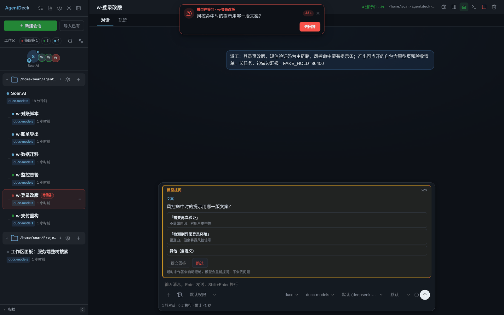</td>
  </tr>
  <tr>
    <td align="center"><sub>跨会话消息：SendMessage 发件卡片，正文与收件人都在卡上</sub></td>
    <td align="center"><sub>提问强提示：55 秒倒计时 + 顶部横幅，跨会话也能看见</sub></td>
  </tr>
</table>

> 以上截图来自隔离演示实例，会话、看板与统计均为演示数据。

> **浏览器 PoC（实验分支）**：设置页可开启本地 Chrome，Claude 通过 MCP 使用 `browser_*` 工具，Web 面板可看实时画面并人工接管。默认关闭；Claude/Qoder/Codex/OpenCode 已接，mcode 受项目 .mcp.json 限制未接；能力边界、配置和未完成项见 [docs/browser-poc.md](docs/browser-poc.md)。

---

## 快速开始

```bash
# 构建：产出单个二进制，前端已内嵌
go build -o cc-webui .

# 配置
cp config.example.yaml config.yaml
# 编辑 config.yaml：设置 gateway_token、你的 clis 与 providers
# 百度内部只用 ducc / ducx（模型清单由 CLI 自己提供，无需声明）：
#   cp du_int.config.example.yaml config.yaml

# 运行
./cc-webui
# 浏览器打开 http://<host>:8321，输入 gateway_token 登录
```

也支持环境变量覆盖：

```bash
GATEWAY_TOKEN=xxx CC_WEBUI_LISTEN=0.0.0.0:8321 ./cc-webui
```

命令行参数：`-config <path>`、`-listen <addr>`。

---

## 配置示例

```yaml
listen: "0.0.0.0:8321"
gateway_token: "change-me-to-a-long-random-string"
data_dir: "./data"      # 会话元数据 + 事件流
default_cwd: "~"        # 新建会话默认工作目录

# 三层正交结构（kind 决定引擎，缺省 claude）：
#   clis[]      - 一个 CLI 二进制安装
#   providers[] - 一个 API 后端（共享 env，通常是 BASE_URL / TOKEN）
#   providers[].models[] - 该后端可选的模型（可带自己的 env）
# 生效 env：cli.env → provider.env → model.env（后者覆盖前者）
clis:
  - name: "official-claude"
    kind: "claude"               # 缺省；Claude Code 及兼容 CLI（stream-json 协议）
    path: "claude"
    permission_mode: "default"   # 默认走 Web 审批卡；bypassPermissions 才全放行
    partial_messages: true   # 打字机式逐 token 流式渲染（需新版 Claude Code）
    args: []
    env: {}

  - name: "ducc"
    kind: "claude"
    path: "/home/you/.baidu-cc/baidu-cc/bin/ducc"
    permission_mode: "default"
    args: []
    env: {}

  - name: "opencode"
    kind: "opencode"             # 实况走 opencode serve；凭据在 opencode 自己的 auth.json
    path: "/home/you/.opencode/bin/opencode"
    permission_mode: "default"
    args: []
    env: {}

  - name: "mcode"
    kind: "mcode"                # MiniMax Code；permission_mode 映射为 full / smart
    path: "mcode"
    args: []
    env: {}

  - name: "qoder"
    kind: "qoder"                # Qoder CLI CN（Claude Code 的 fork）
    path: "qoderclicn"
    permission_mode: "default"
    args: []
    env: {}

  - name: "codex"
    kind: "codex"                # Codex CLI；ducx 同协议，需 home + model_provider
    path: "codex"
    permission_mode: "default"   # default → workspace-write 沙箱；bypassPermissions 才放行
    args: []
    env: {}

providers:
  - name: "anthropic"
    env: {}
    models:
      - name: "claude-sonnet-4-5"
        input: [text, image]

  - name: "kimi"
    env:
      ANTHROPIC_BASE_URL: "http://127.0.0.1:3456"
      ANTHROPIC_AUTH_TOKEN: "..."
    models:
      - name: "kimi-k3"
        input: [text, image]
      - name: "kimi-k2.7"
        env:
          CLAUDE_CODE_AUTO_COMPACT_WINDOW: "1000000"

  - name: "kimi-for-coding"      # opencode 的 provider 名必须等于 opencode 的 providerID；
                                 # 登录的集成会被自动发现，这条是可选的显式声明
    kind: "opencode"
    env: {}                      # 凭据走 opencode 登录态
    models: []                   # 留空：模型清单由 CLI 动态提供

  - name: "codex"
    kind: "codex"
    env: {}
    models: []                   # 留空：来自 `codex debug models --bundled`
```

完整字段请参考 `config.example.yaml`（只保留 ducc / ducx 的百度内部精简版见 `du_int.config.example.yaml`）。`html_render_hint: false` 可关闭每轮向模型注入的 HTML/Mermaid 输出约定。

### 热加载

运行中的进程每 3 秒检查一次 `config.yaml`，发现改动即热加载：clis / providers / models 的增删改立即生效——**已开启的会话也能在模型选择列表里看到新模型**（后端经 SSE 推送 `config_changed`，前端自动重拉并刷新下拉，已选模型不变）。配置文件解析失败时保持旧配置，并在日志里报错，修复后自动恢复。

`listen` 与 `data_dir` 是启动时固化的字段，改动后需重启；`gateway_token` 改动会随热加载生效，但现有客户端的登录态会失效，需用新 token 重新登录。

---

## 工作原理（简要）

AgentDeck 有五个引擎，由 `config.yaml` 里 cli/provider 的 `kind` 决定（`claude` 缺省，另有 `opencode`、`mcode`、`qoder` 与 `codex`）。会话绑定单一引擎，创建时 cli 与 provider 的 kind 必须一致。

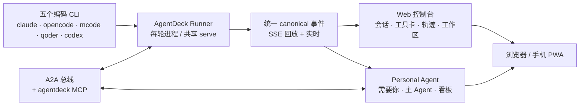

| 引擎 | 实况通道 | 会话 id | 历史回放来源 |
|---|---|---|---|
| `claude` | 每条消息一个 `claude -p --output-format stream-json --verbose [--resume <sid>] [--model <m>]` 进程，prompt 走 stdin | uuid | `~/.claude/projects/**/<sid>.jsonl` |
| `opencode` | 共享长驻 `opencode serve`：HTTP 建会话 / 发 prompt，`/event` SSE 取事件（**不是** `opencode run`） | `ses_…` | `opencode export <sid>` |
| `mcode` | `mcode exec --output-format stream-json [--session <mvs_…>] [--model <p/m>] [--effort <l>]` | `mvs_…` | `~/.minimax/v2/sessions/**/messages.jsonl` |
| `qoder` | `qoderclicn -p --output-format stream-json [--resume <sid>] [--model <m>] [--reasoning-effort <l>]`（没有 `--verbose`） | uuid | `~/.qoder-cn/projects/**/<sid>.jsonl` |
| `codex` | `codex exec --json [resume <sid>] [-m <m>] [-c model_reasoning_effort=<l>]`，prompt 走 stdin | thread uuid | `$CODEX_HOME/sessions/**/rollout-*-<sid>.jsonl`（ducx 为 `~/.baidu-cx`） |

五个引擎的内部事件格式不完全相同，但都经各自的适配层转成同一套 canonical 事件再渲染，所以工具卡片、轨迹视图、回放/实时一致性在前端是共用一套逻辑的。`qoder`（Qoder CLI CN）是 Claude Code 的 fork，事件格式与 transcript 布局都与 `claude` 同构，只是没有 `--verbose`、档位 flag 叫 `--reasoning-effort`、权限模式用下划线拼写，历史放在 `~/.qoder-cn` 下——因此它复用 `internal/claudehist`，不需要单独适配层。`opencode` 与 `mcode` 各有一套独立协议和适配层；`codex`（及百度二次封装的 `ducx`）又一套独立协议：`exec --json` 的 JSONL 事件 + rollout 文件回放，由 `internal/codexhist` 适配；模型目录来自 `codex debug models --bundled`。

- **持久化边界**：AgentDeck 自己只落盘 `user`、`status`、`rewind` 三类事件；assistant / tool / thinking 等 stream 事件不落盘，每次 SSE 连接时从各引擎自己的 transcript 现场解析后合并回放。所以历史只有一份权威副本（在 CLI 那边），服务重启不丢，也不会出现两份互相打架的记录。
- **续接**：claude/qoder 首轮从 `system/init` 捕获 `session_id`，后续 `--resume`；opencode 建会话时拿到 `ses_…` 并每轮在 v1 prompt body 里带上当前 model/variant；mcode 用 `--session`；codex 用 `exec resume`。因此**在同一引擎内切换 CLI / Provider / Model / 权限模式不会丢失上下文**（会话不跨引擎迁移）。
- **停止**：claude/qoder/mcode/codex 杀掉当前进程组；opencode 调 serve 的 `interrupt` 接口。
- **轮次边界**：claude/qoder/mcode/codex 以子进程结束或 `result`/`turn.completed` 为准；opencode 是共享长驻进程，靠 `/event` 里的 `session.status`（busy → idle）关闭轮次。
- **回滚**：claude 默认注入 `CLAUDE_CODE_ENABLE_SDK_FILE_CHECKPOINTING=true`，每轮结束扫描 transcript 捕获该用户消息的 `uuid`（= 文件 checkpoint 标识）写回事件。⏪ 时先 `claude --rewind-files <uuid>` 恢复文件，再备份并截断 transcript 与 AgentDeck 事件日志，消息文本回填输入框。回滚第一条消息后 transcript 变空，下一轮自动开新 session。opencode 则用它自己的 `revert/stage` + `revert/commit`，对话与文件由 opencode 的存储回滚。
- **分叉**：claude/qoder 可把当前 transcript 复制成新会话；其余引擎没有可复制的独立 transcript 文件，入口隐藏。

### 可视化输出（HTML / Mermaid）

模型回复里的 `html` 围栏会被 `md()` 升级成带「渲染」按钮的 artifact 壳：默认显示源码，点一下才挂 `sandbox="allow-scripts"` 的 srcdoc iframe。iframe **不给 `allow-same-origin`**，页面碰不到 app 的 localStorage / DOM / 带 cookie 的同源接口；高度跟随内容，外层封顶 640px（可全屏，全屏是搬节点不重建 iframe，页面脚本状态不丢）。宿主还向 iframe 注入主题 CSS 变量（`--background`/`--foreground`/`--accent` 等），页面跟随深浅色。`mermaid` 围栏走同一套壳，点「渲染」才动态加载 `/vendor/mermaid.min.js` 并画成 SVG（`securityLevel:'strict'`，产出再过一遍 DOMPurify），切主题会重画。轨迹视图不渲染 frame，只看代码。

为了让模型知道这个能力，服务端每轮向 system prompt 注入一段约定（图表/仪表盘直接输出 HTML 围栏，不要写 `.html` 文件）。注入路径按引擎而异：claude/qoder/mcode 走 `--append-system-prompt`，codex 走 `-c instructions=<TOML 字符串>`，opencode 走它自己的 `instructions` 配置（AgentDeck 维护隔离的 `~/.config/cc-webui/opencode/`，不碰用户全局规则）。`html_render_hint: false` 可整体关闭。

### 自动续跑目标（Session Goals）

会话说「一直干到这条条件成立为止」：每轮**干净**结束后，runner 向模型注入一轮自评，正文最后一行的 `<!--goal:met-->` / `<!--goal:unmet ... -->` 决定是否达标；未达标就自动再排一轮。判定者是模型自己，所以条件写得越可验证越稳（`go test ./... 全绿` 好过「功能完成」）。熔断是 `max_turns`（默认 20，上限 200）与 `max_hours`（默认 4h，上限 48h）。用户停止 → 终态 `stopped`；rewind → 直接清空（回滚掉的正是目标在追的工作）。目标状态一律回读服务端，UI 只显示。

### 常驻（claude）与跨引擎 A2A

**A2A 总线对五个引擎都可用**：`POST /api/a2a/send {from,to,message,send_id?}` 按 session id 或地址名找到目标，把消息排成目标的一轮；接收方不需要常驻。入站事件带 `source:"a2a"` / `from` / `body`，前端渲染为 peer 气泡，轨迹视图归入 A2A，回放时与引擎 transcript 的回显去重。主 Agent 和 worker 可以分别使用不同引擎，详见 [a2a-rd.md](a2a-rd.md)。

**常驻是 claude 侧的可选增强**：开启常驻后，会话保持一个 `--input-format stream-json` 的双向进程在线，并把地址名写成 Claude transcript 末尾的 `custom-title`，CLI 据此注册 messaging socket；claude 原生 `SendMessage` 仍可作为 A2A 的兼容通道。地址名变更需要重启常驻进程；rewind 会先拆掉常驻进程再截断 transcript，避免进程内存与磁盘历史分叉；服务重启后自动按已保存的地址名恢复。

用主 Agent 给多个 worker 派工、worker 用 A2A 回报的用法，见 [docs/main-agent-best-practices.md](docs/main-agent-best-practices.md)。

### 关于 env 注入

Claude Code 的 `~/.claude/settings.json` 里的 `env` 段会覆盖进程继承的环境变量，因此只往进程注入 `ANTHROPIC_BASE_URL` 等并不生效。AgentDeck 的处理方式：

1. 合并当前会话的生效 env（cli → provider → model，后者覆盖前者）。
2. 合并结果非空时，物化为 `data/settings/<cli>__<provider>__<model>.json`（权限 0600），以 `--settings <绝对路径>` 传给 claude/qoder——命令行 settings 优先级最高，可以压过 `settings.json`。env 为空的 provider（如 `ducc-models`）端点由 CLI 自己解析，不物化也不传这个文件（否则命令会钉死在本机 data 目录的绝对路径上，换机器即失效）。
3. 同时把生效 env 注入进程环境变量，供其他 CLI 兼容层使用。
4. **推理档位**：`CLAUDE_CODE_EFFORT_LEVEL`（常见于用户全局 settings）会压过 `--effort`，所以会话指定的档位还会写进物化 settings 的 env（文件名带 `__effort-<level>`，不同档位不共用文件）。codex 走 `-c model_reasoning_effort`；opencode 走模型自身的 variant（建会话时带上、之后每轮在 v1 prompt body 里覆盖）；qoder 走 `--reasoning-effort`；mcode 走 `--effort`。
5. opencode / mcode / qoder / codex 的凭据来自各自 CLI 的登录态或 `auth.json`，config 的 env 对它们不生效（codex/ducx 例外地需要 `-c` 时同时钉住 `model_provider`，否则 ducx 会退回官方端点）。

---

## 安全说明

- **鉴权**：所有 API 与 SSE 接口都需要 `gateway_token`。支持 Cookie `ccgw_token`、`Authorization: Bearer <token>` 或 `?token=` 查询参数。
- **文件预览白名单**：`/api/files` 仅允许读取**位于任一会话工作区（cwd）内**的文件，并会 `EvalSymlinks` 解析真实路径，防止通过软链接或 `..` 穿越到 `/etc/passwd`、`~/.ssh` 等敏感目录。
- **只读 + 截断**：文件预览为只读，上限 2 MiB；检测到二进制内容（NUL 字节）会拒绝返回。
- **图片接口**：`/api/image` 是 `/api/files` 的孪生口子，同样限制在会话工作区内，额外要求扩展名属于图片白名单（不含 svg）、体积 ≤10 MiB，并带 `nosniff`。
- **HTML 沙箱**：渲染的 iframe 不带 `allow-same-origin`，页面无法访问宿主 DOM、localStorage 或带 cookie 的同源接口。
- **settings 文件**：`data/settings/*.json` 含端点凭据，权限 0600，env 值不会下发前端。
- **提醒**：请把 `gateway_token` 设置为强随机字符串，并避免在公网直接暴露端口。建议通过反向代理或 VPN 使用。

---

## 部署到其他机器

```bash
# 交叉编译（例如在 macOS 上编译给 Linux）
GOOS=linux GOARCH=amd64 go build -o cc-webui .

# 拷贝二进制 + 一份 config.yaml 到目标机器即可，无运行时依赖
scp cc-webui config.yaml user@remote:~/
ssh user@remote 'GATEWAY_TOKEN=xxx ./cc-webui'
```

目标机器需要至少一个可用的受支持 CLI（claude / opencode / mcode / qoder / codex），并在 `config.yaml` 中正确配置。

---

## API 概览

| 方法 | 路径 | 说明 |
|---|---|---|
| POST | `/api/login` / `/api/logout` | `{token}` 登录并写入 Cookie / 退出 |
| GET | `/api/me` | 当前登录信息 |
| GET | `/api/clis` / `/api/providers` / `/api/profiles` / `/api/config` | 下拉与运行时配置（env 值不下发） |
| GET / POST | `/api/sessions` | 会话列表（含状态、待回答提问、resume 命令）/ 创建 |
| GET | `/api/needs-you` | Personal Agent「需要你」队列（权限/提问/待人工/待验收及计数） |
| GET | `/api/agent-board` / `/api/agent-board/events` | 看板快照 / 变更 SSE |
| POST | `/api/agent-board/tasks/{id}/events` | 追加看板任务时间线 |
| POST | `/api/a2a/send` | 引擎中立跨会话消息 `{from,to,message,send_id?}` |
| GET / PATCH / DELETE | `/api/sessions/{id}` | 详情 / 改名·换 profile·model·档位·权限·常驻·地址名 / 删除 |
| POST | `/api/sessions/{id}/messages` | 发送消息 `{text, images, files}` |
| POST | `/api/sessions/{id}/uploads?name=` | 上传附件（落盘后经消息文本引用，同名文件不覆盖） |
| POST | `/api/sessions/{id}/stop` | 中断当前轮 |
| PUT / DELETE | `/api/sessions/{id}/goal` | 设置自动续跑目标 / 清除 |
| POST | `/api/sessions/{id}/fork` | 分叉会话（claude / qoder） |
| POST | `/api/sessions/{id}/rewind` | 回滚到某条用户消息 `{checkpoint}`（claude / opencode） |
| POST | `/api/sessions/{id}/permissions/request` | 审批 helper 上报工具调用（阻塞等决策，内部用） |
| POST | `/api/sessions/{id}/permissions/{pid}` | 审批决策 `{behavior: allow\|allow_tool_session\|deny, message?}` |
| GET | `/api/sessions/{id}/permissions/pending` | 未决审批列表（重连补卡） |
| GET | `/api/sessions/{id}/events` | SSE：历史回放 + 实时事件 |
| GET / POST | `/api/groups` | 群列表 / 建群 `{name, cwd, members[]}` |
| GET / DELETE | `/api/groups/{id}` | 群详情＋transcript / 解散群聊 |
| PATCH | `/api/groups/{id}/members/{memberId}` | 改单个成员档案（下轮生效） |
| POST | `/api/groups/{id}/messages` | 群发消息（`@成员/@all`，忙时 409） |
| POST | `/api/groups/{id}/stop` | 停本轮（全员） |
| GET | `/api/groups/{id}/events` | SSE：群回放＋实时事件 |
| GET | `/api/claude-sessions(+preview)?cwd=` | 扫描本机 `~/.claude/projects` |
| GET | `/api/qoder-sessions(+preview)?cwd=` | 扫描本机 `~/.qoder-cn/projects` |
| GET | `/api/opencode-sessions(+preview)?cli=&cwd=` | 扫描 opencode 会话（cwd 空 = 跨项目枚举） |
| GET | `/api/mcode-sessions(+preview)?cli=&cwd=` | 扫描 mcode 会话 |
| GET | `/api/codex-sessions(+preview)?cli=&cwd=` | 扫描 codex/ducx 的 rollout 目录 |
| GET | `/api/opencode-models?cli=&provider=` | opencode 可用模型 + 输入模态（`opencode models <provider> --verbose`，10 分钟缓存，后台刷新） |
| GET | `/api/opencode-model-variants?cli=&provider=` | opencode 每个模型可用的 `--variant` 档位（与上一项共用同一次 CLI 调用与缓存） |
| GET | `/api/mcode-models?fresh=` | mcode 可用模型 + 推理档位 + 输入模态（读 `~/.minimax/config.yaml`） |
| GET | `/api/qoder-models?cli=&provider=` | qoder 可用模型 + 推理档位（`qoderclicn --list-models`，10 分钟缓存） |
| GET | `/api/codex-models?cli=&provider=` | codex 可用模型 + 推理档位 + 输入模态（原生 codex 读 `debug models --bundled`；ducx 读 `<home>/model-catalogs/<provider>-models.json`，10 分钟缓存） |
| POST | `/api/sessions/import` | 导入已有 session（按 cli 的 kind 决定读哪个引擎的历史） |
| GET | `/api/stats?fresh=1` | 五引擎合并使用统计（默认走增量缓存） |
| GET / PUT | `/api/notes` | 全局待办备忘（前端全量覆盖写） |
| GET | `/api/files?path=` | 读取本地文件（限会话工作区内） |
| GET | `/api/image?path=` | 读取本地图片（限会话工作区内，服务模型回复里的本地图片） |
| GET | `/api/sessions/{id}/workspace/tree?path=` | 工作区面板：列一层目录（`path` 相对会话 cwd） |
| GET | `/api/sessions/{id}/workspace/file?path=` | 工作区面板：读一个文件（限该会话工作区内） |
| GET | `/api/sessions/{id}/workspace/status` | 工作区面板：git 改动清单（给文件树打标记） |
| GET | `/api/sessions/{id}/workspace/diff?path=` | 工作区面板：某文件的 git diff（未跟踪文件按新增整段返回） |
| POST | `/api/sessions/{id}/workspace/open` | 工作区面板：用系统默认程序打开文件 `{path}` |

---

## 项目结构

```
main.go                  # 入口 + go:embed
internal/config/         # 配置加载 + 热加载
internal/store/          # 会话元数据、事件日志、目标、备忘持久化
internal/runner/         # CLI 进程管理：队列、流解析、事件广播、停止、常驻、目标
internal/server/         # HTTP 路由、鉴权、SSE、群聊、统计、文件/图片
internal/claudehist/     # ~/.claude 与 ~/.qoder-cn 的 projects 扫描、导入转换、统计
internal/opencodehist/   # opencode 引擎适配：事件转换、export 回放、模型变体、统计
internal/opencodeapi/    # opencode serve 客户端：HTTP + SSE、权限/提问回复、revert
internal/mcodehist/      # mcode 引擎适配：stream-json 事件转换、transcript 回放、模型目录、统计
internal/codexhist/      # codex/ducx 引擎适配：exec --json 事件转换、rollout 回放、模型目录、统计
internal/statsagg/       # 五引擎共用的统计聚合核心
internal/a2a/            # 引擎无关注跨会话消息：信封、agentdeck MCP 工具面、A2A 投递
internal/boarddb/        # SQLite 看板：任务、时间线、产物、worker 绑定
docs/needs-you-rd.md     # Personal Agent「需要你」队列设计
web/                     # 免构建前端（vanilla JS + vendor 的 marked/DOMPurify/highlight.js/mermaid）
web/agent*.js            # Personal Agent：队列、右栏、折叠、作答路径
```

---

## 反馈与贡献

如果你在使用过程中遇到问题，或者有新功能建议，欢迎提交 Issue 或 PR。

---

*AgentDeck 是一个社区驱动的多引擎 AI 编码 Web 控制层，不是 Anthropic 官方产品。*
