<p align="center">
  
</p>

<h1 align="center">AgentDeck</h1>

<p align="center">
  <b>五个编码 CLI，一个能在手机浏览器里用的控制台</b>
</p>

<p align="center">
  Claude Code · opencode · MiniMax Code · Qoder · Codex —— 同一套会话、工具卡、回滚与协作
</p>

<p align="center">
  <a href="https://github.com/yhx5768/AgentDeck/releases/latest"></a>
  <a href="https://github.com/yhx5768/AgentDeck"></a>
  <a href="https://github.com/yhx5768/AgentDeck"></a>
  <a href="https://github.com/yhx5768/AgentDeck"></a>
</p>

<p align="center">
  <a href="#核心能力">核心能力</a> ·
  <a href="#界面">界面</a> ·
  <a href="#快速开始">快速开始</a> ·
  <a href="#配置">配置</a> ·
  <a href="#工作原理">工作原理</a> ·
  <a href="#api-概览">API</a> ·
  <a href="#安全边界">安全</a> ·
  <a href="#faq">FAQ</a>
</p>

<p align="center">
  <a href="docs/images/readme/readme-pa-overview.png">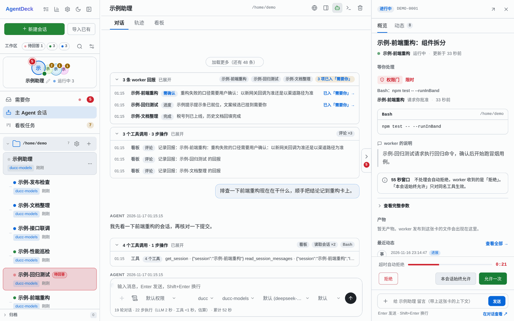</a>
</p>

<p align="center">
  <sub>Personal Agent 工作台 · 左栏主 Agent 与运行中的 worker，中栏按轮折叠的回报，右栏就地处理权限门、提问与验收</sub>
</p>

---

## 核心能力

AgentDeck 是一个跑在本机或远程服务器上的单文件 Go 服务：它调用你已经装好的编码 CLI，把每一轮的流式回复、工具调用、审批和提问搬进浏览器。前端资源用 `go:embed` 打进二进制，没有 Node 构建步骤——拷一个可执行文件和一份 `config.yaml` 过去就能跑。

典型用法：在远程开发机、跳板机或容器里跑 AgentDeck，笔记本和手机打开浏览器继续跟进；同一台机器上并行维护多个项目的会话；或者让一个主 Agent 统一派工、worker 各自干活并回报验收。

### 五个引擎，一套界面

`config.yaml` 里 cli / provider 的 `kind` 决定会话用哪个引擎：`claude`（缺省，Claude Code 及同协议的厂商封装）、`opencode`、`mcode`（MiniMax Code）、`qoder`（Qoder CLI CN）、`codex`（Codex CLI 及同协议的厂商封装）。会话绑定单一引擎，创建时 cli 与 provider 的 kind 必须一致；之后换模型、档位、权限模式都不丢上下文，只是不跨引擎迁移。

四个非 claude 引擎的模型清单由各 CLI 自己提供，配置里留空才是对的：opencode 读 `opencode models`（登录过的 provider 还会被自动发现），mcode 读它自己的运行时配置，qoder 读 `qoderclicn --list-models`，codex 读 `debug models --bundled`，封装版则读它自己的 wrapper 模型目录。写死模型名一定会过期。

各引擎的实况通道与历史来源见 [工作原理](#工作原理)。

### Personal Agent：一个主 Agent 带多个 worker

打开「设置 → 界面形态 → Personal Agent」，控制台从会话瀑布流切换成三栏：

- **左栏**：主 Agent 头像簇 + 运行中的 worker；三个入口——需要你、主 Agent 会话、看板任务。
- **中栏**：需要你队列 / 主 Agent 会话 / 看板任务。会话里连续的 worker 回报按人类轮次折叠成「N 条 worker 回报」，主 Agent 自己的看板工具调用折成「N 次看板操作」；人类消息和最终回复不折。
- **右栏**：卡片优先详情——概览、动态、产物、等你处理，底部是常驻的 composer；打开 worker 会话时整栏收起。

主 Agent 和 worker 都是**真实会话**，没有前端 mock：`/api/needs-you`、`/api/agent-board(+events)`、`/api/sessions/{id}/permissions/pending`、`/api/a2a/send` 一一对应，worker 的每一步工具调用都能点开看，也能单独打开它的回放。

### A2A 总线：引擎中立，不要求常驻

主 Agent 用 Claude Code、支付 worker 用 opencode、迁移 worker 用 codex，完全没问题。每个会话可以设一个 `peer_name`（地址名），`POST /api/a2a/send {from,to,message,send_id?}` 按 session id 或地址名找到目标，把消息排成它的一轮——和用户发消息走同一条 `Enqueue` 路径，接收方**不需要常驻**。

入站消息落成一条 `source:"a2a"` 的 user 事件，前端渲染成紫色 peer 气泡，回放与实况一致。每个引擎都会注入 agentdeck MCP：会话管理（`list_sessions` / `new_session` / `get_session` / `stop_session`）、A2A（`send_message`，支持 `send_id` 幂等）、读写 transcript（`read_session_messages` / `search_messages`），主 Agent 另有看板工具（`board_*`）。绑了看板卡的 worker 异常结束、卡住或停在人工门上时，runtime 会代它向主 Agent 发通知——出事的那个进程通常已经发不出消息了。

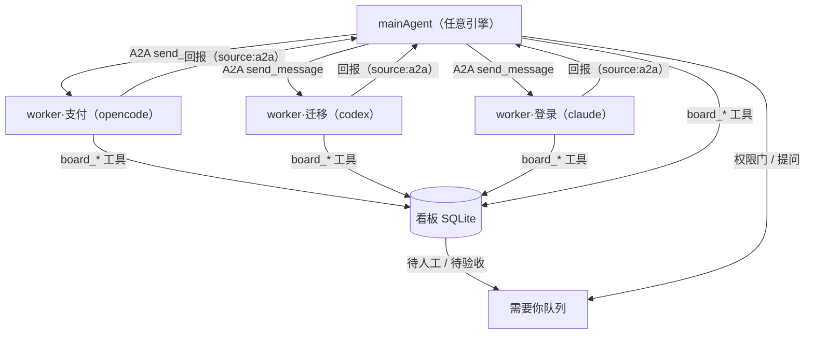

设计细节见 [a2a-rd.md](a2a-rd.md)，派工与回报的写法见 [docs/main-agent-best-practices.md](docs/main-agent-best-practices.md)。

### 需要你：只在需要人时打断你

权限门、AskUserQuestion、看板里的「待人工 / 待验收」合并成一条按紧急度排序的队列。门有 **55 秒**硬超时——到点自动拒绝，模型收到的是「拒绝」，不会被假装成通过；已经处理过的条目会留下如实回执。

因为 SSE 只订阅当前会话，模型在别的会话里提问时你可能完全收不到。所以提问还有三条兜底：**顶部居中横幅**（整条可点，直达那张卡）、侧栏**整行底色脉动**、工作区栏的「待回答 N」徽标。轮询 diff 是唯一能看见跨会话提问的通道，不刷新也不会漏。

作答就是发真实请求：权限与提问直达 worker；拍板 / 打回先送达 worker，再记时间线、改看板状态；A2A 回执带操作级幂等键，重试不会吞掉第二次决定。

### 每一轮都看得见

- **流式对话**：SSE 推送，Markdown、代码高亮、工具调用折叠块、token 与花费统计、排队与停止。CLI 开 `partial_messages` 后是逐 token 的打字机效果。
- **工具卡片**：Bash 终端视图、Read/Write/Edit 的 diff、TodoWrite 检查清单、thinking 折叠块、子代理折叠卡片。
- **轨迹视图**：把同一份事件流投影成按轮分组的台账，按角色筛选、关键词搜索，点开单条看 summary / preview / raw 三档。
- **工作区面板**：右侧文件树（懒加载、可筛选、可只看有改动）+ 文件预览（Markdown、代码高亮、图片），改动走 `git diff`。路径严格限制在**当前会话的工作区**内。
- **使用统计**：五个引擎的会话合并计数，8 个指标 + GitHub 式热力图，增量缓存。

### 回滚、分叉、回到 TUI

每条带文件 checkpoint 的用户消息都能 ⏪ 回滚。claude 先 `--rewind-files` 恢复文件、删除期间新建的文件，再截断 transcript 与事件日志，消息文本回填输入框；opencode 走它自己的 `revert/stage` + `commit`。Bash 改的文件不在 checkpoint 内——这一点不打算假装能兜住。

claude / qoder 还能把当前 transcript 复制成新会话，从同一上下文另开一条分支。每个会话都保留引擎自己的 session id，点「resume」复制命令就能回到 TUI 继续，Web 里做的一切状态都在：claude/qoder 带 `--model` 与档位，opencode 是 `-s <sid>`，mcode 是 `--session <mvs_…>`，codex 是 `resume <sid>`。

### 输出：HTML 图表、Mermaid 与产物

模型回复里的 `html` 围栏可以点「渲染」变成沙箱 iframe——小型图表、交互页面都行；`mermaid` 围栏点一下画成图，并跟随深浅主题重绘。iframe 只给 `allow-scripts`，**不给 `allow-same-origin`**，页面碰不到宿主的 localStorage、DOM 和带凭据的同源接口。

完整报告 / 仪表盘 / 多图表分析优先发布成会话或看板的 **HTML 产物**（`artifact_publish`），聊天里只回产物链接和 3–5 条关键结论。产物可以签一个免登录的公开链接给人看，PV / UV 按分享统计，随时可撤销——服务端只存 token 的哈希。

### 挂一条目标，让它自己跑完

给会话挂一条「一直干到这条条件成立为止」：每轮干净结束后模型自评，未达标自动再排一轮。判定者是模型自己，所以条件写得越可验证越稳（`go test ./... 全绿` 好过「功能完成」）。`max_turns`（默认 20）与 `max_hours`（默认 4h）双熔断，随时可停；rewind 会清空目标。

---

## 界面

以下为 Personal Agent 的主要界面（截图使用示例会话）。

<table>
  <tr>
    <td width="50%" align="center">
      <a href="docs/images/readme/readme-created-mainagent.png">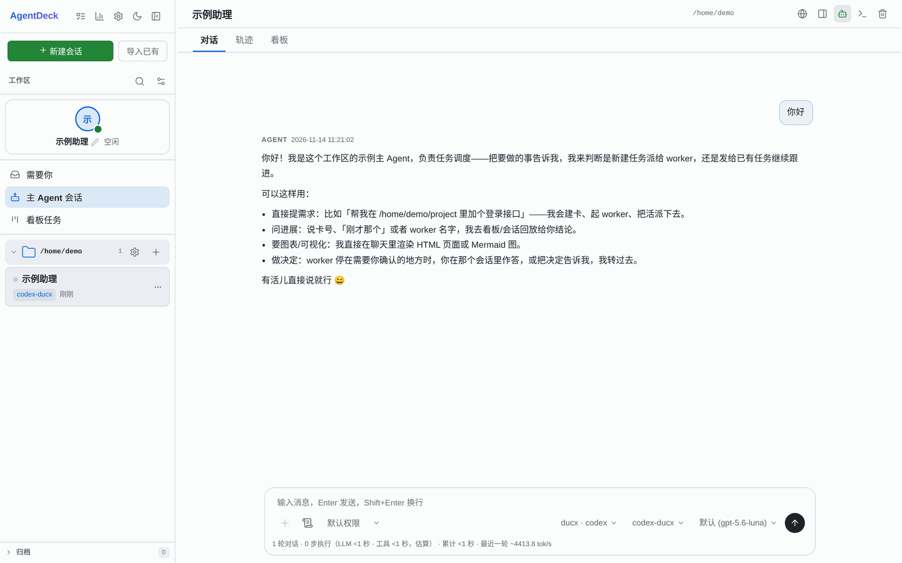</a><br>
      <sub><b>创建主 Agent</b> · 选 CLI / provider / 模型 / 工作目录，中栏直接提需求</sub>
    </td>
    <td width="50%" align="center">
      <a href="docs/images/readme/readme-pa-a2a.png">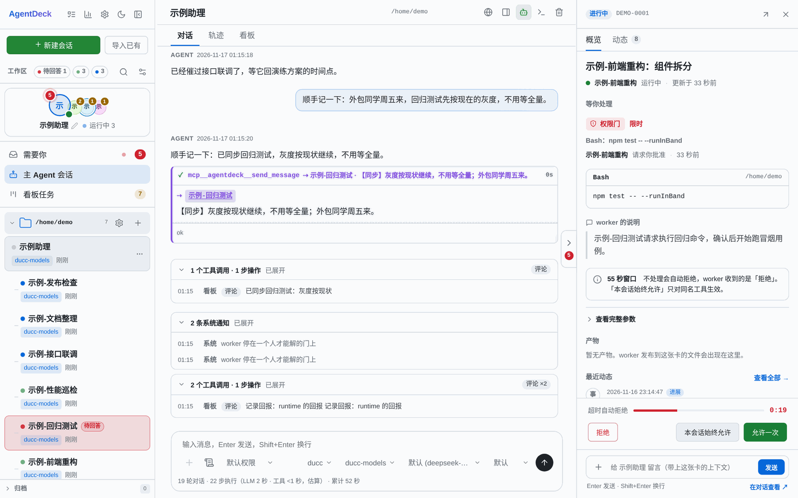</a><br>
      <sub><b>A2A</b> · 派工卡片与 worker 回报按轮折叠</sub>
    </td>
  </tr>
  <tr>
    <td width="50%" align="center">
      <a href="docs/images/readme/readme-pa-board.png">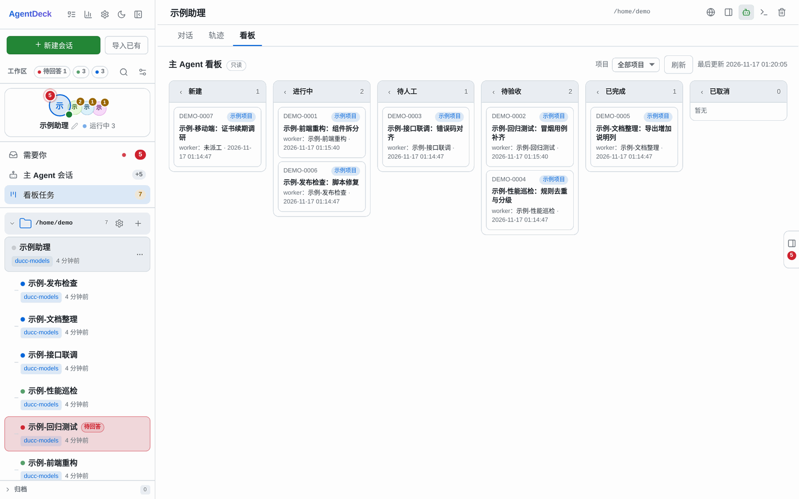</a><br>
      <sub><b>看板</b> · 按状态分列，点卡片在右栏看详情</sub>
    </td>
    <td width="50%" align="center">
      <a href="docs/images/readme/readme-pa-needs-you.png">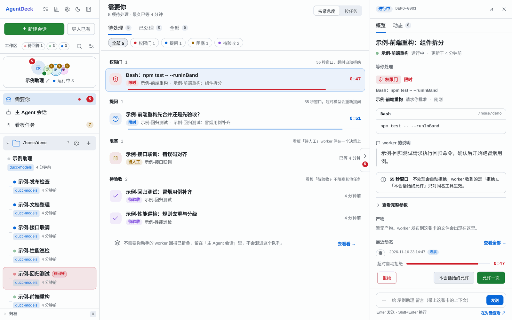</a><br>
      <sub><b>需要你</b> · 权限门、提问、阻塞与待验收汇成一条队列</sub>
    </td>
  </tr>
</table>

<p align="center">
  <a href="docs/images/readme/readme-created-mainagent-mobile.png">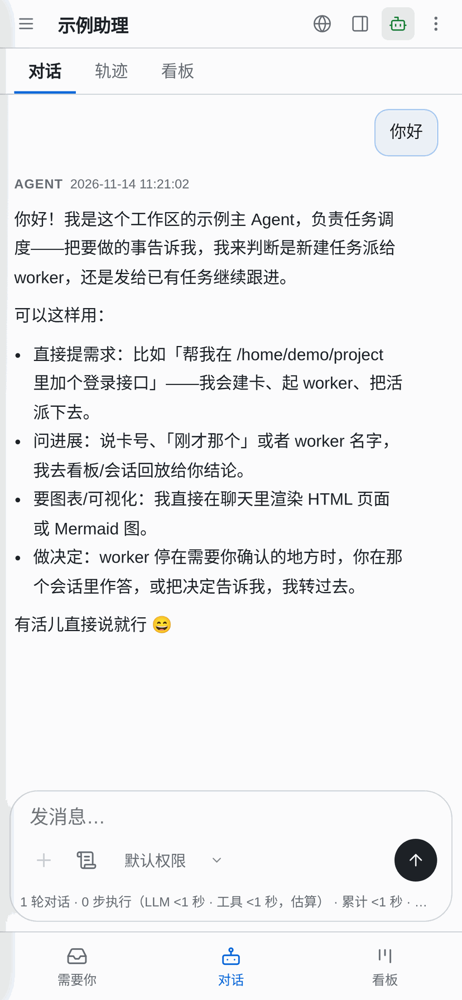</a><br>
  <sub>手机端：单栏对话，底部切换「需要你 / 对话 / 看板」，iOS 独立 PWA 会避开状态栏安全区</sub>
</p>

<details>
<summary>更多界面（深色主题）</summary>

<table>
  <tr>
    <td width="50%" align="center">
      <a href="docs/screenshots/readme-ask-banner.png">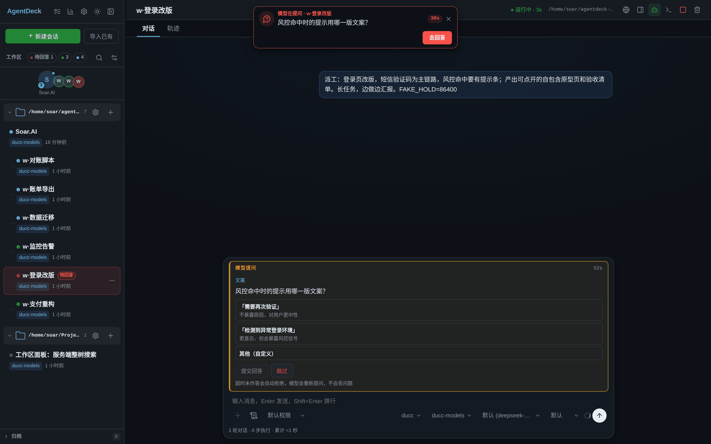</a><br>
      <sub><b>提问提示</b> · 顶部横幅、侧栏脉动与倒计时，跨会话也不漏</sub>
    </td>
    <td width="50%" align="center">
      <a href="docs/screenshots/readme-workspace.png">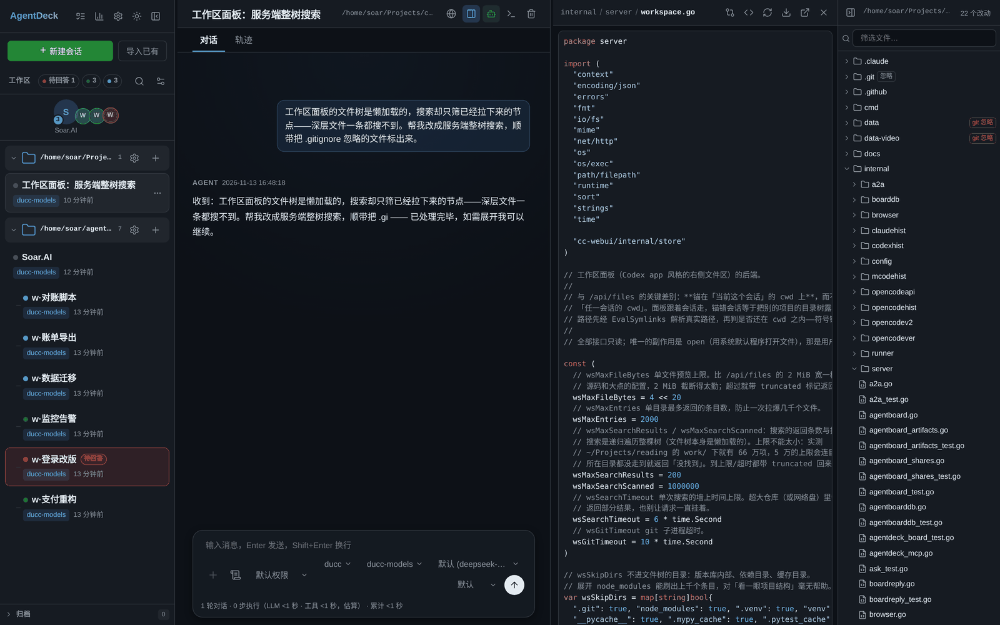</a><br>
      <sub><b>工作区</b> · 文件树、服务端整树搜索、diff 与预览</sub>
    </td>
  </tr>
  <tr>
    <td width="50%" align="center">
      <a href="docs/screenshots/readme-stats.png">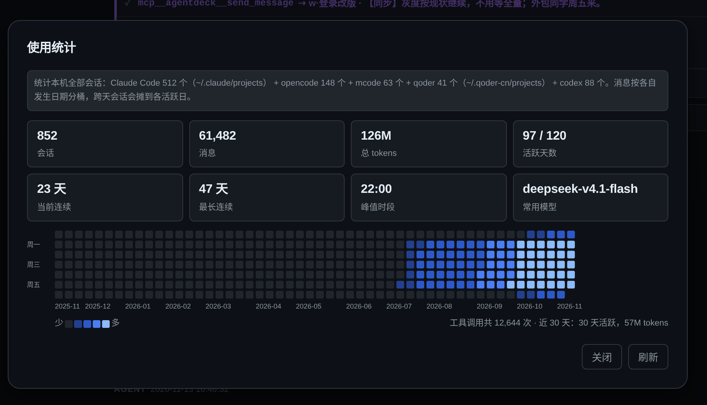</a><br>
      <sub><b>统计</b> · 五引擎合并计数，按日按模型看 tokens</sub>
    </td>
    <td width="50%" align="center">
      <a href="docs/screenshots/readme-trajectory.png">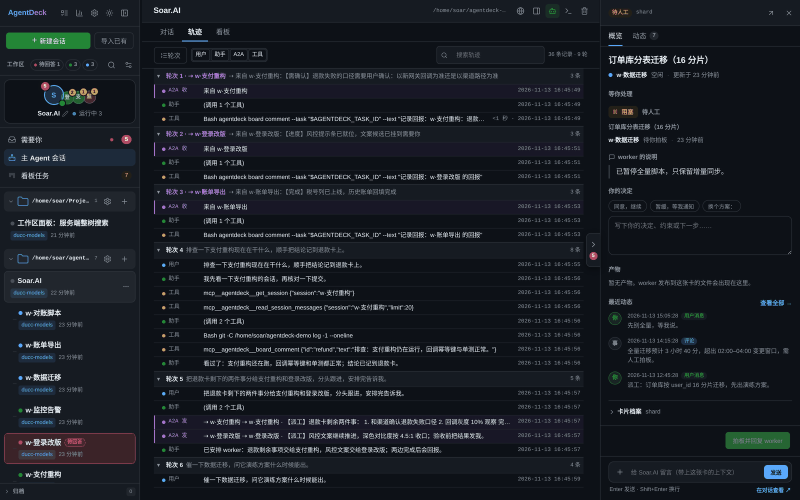</a><br>
      <sub><b>轨迹</b> · 同一份事件流的另一种审阅视角</sub>
    </td>
  </tr>
</table>

</details>

> **浏览器 PoC（实验分支）**：设置页可开启本地 Chrome，Claude 通过 MCP 使用 `browser_*` 工具，Web 面板能看实时画面并人工接管。默认关闭；Claude / Qoder / Codex / OpenCode 已接，mcode 受项目 `.mcp.json` 限制未接。能力边界见 [docs/browser-poc.md](docs/browser-poc.md)。

---

## 快速开始

### 安装

Linux / macOS 用安装脚本，已装过的旧版本会迁移到 `agentdeck`（原文件保留为 `cc-webui.bak-<版本>`）：

```bash
curl -fsSL https://raw.githubusercontent.com/yhx5768/AgentDeck/master/scripts/install-agentdeck.sh | bash
```

脚本源码就在仓库里：[scripts/install-agentdeck.sh](scripts/install-agentdeck.sh)。上面的命令始终取 master 上的最新版；配置模板（[`config.example.yaml`](config.example.yaml)）也是从仓库 raw 下载，与二进制同源。

安装时脚本会自动探测本机的 `claude` / `codex` / `opencode` 并写进 `config.yaml`；没装的那些保留命令名占位，之后装上就能直接用，不用改配置。引擎是 CLI 提供的，装几个用几个。

也可以直接从 [Releases](https://github.com/yhx5768/AgentDeck/releases/latest) 下载对应平台的二进制，解压即用。旧名 `cc-webui` 仍可继续运行，Release 会同时提供 `agentdeck-*` 与兼容用的 `cc-webui-*` asset。

### 从源码构建

```bash
# 构建：产出单个二进制，前端已内嵌
go build -o agentdeck .

# 配置
cp config.example.yaml config.yaml
# 或者用精简示例（只配 Claude Code / Codex，模型清单由 CLI 自己给）：
#   cp du_int.config.example.yaml config.yaml

# 运行
./agentdeck
# 浏览器打开 http://<host>:8321，输入 gateway_token 登录
```

目标机器需要至少一个可用的受支持 CLI，与 `config.yaml` 里声明的路径一致。

### 首次启动

首次启动进入 Personal Agent，没有主 Agent 时会显示创建引导：选 CLI、provider、模型（可留空用 CLI 默认）、工作目录和显示名即可。

想跳过引导、启动时就自动创建，可以在设置页打开「首次启动自动创建主 Agent」，或在 `config.yaml` 里写 `main_agent.autocreate: true`（默认关闭）。

### 命令行参数与环境变量

| 参数 / 变量 | 说明 |
|---|---|
| `-config <path>` | 配置文件路径，默认 `./config.yaml` |
| `-listen <addr>` | 覆盖监听地址，例如 `0.0.0.0:8321` |
| `-version` | 打印版本后退出 |
| `GATEWAY_TOKEN` | 覆盖配置里的 `gateway_token`；不配则首次启动生成 |
| `CC_WEBUI_LISTEN` / `CC_WEBUI_DATA_DIR` | 覆盖监听地址 / 数据目录 |

```bash
GATEWAY_TOKEN=xxx ./agentdeck -listen 0.0.0.0:8321
```

---

## 配置

三层正交结构：`clis[]`（一个 CLI 安装）× `providers[]`（一个 API 后端）× `providers[].models[]`（可选模型）。生效 env 按 `cli.env → provider.env → model.env` 合并，后者覆盖前者。

```yaml
listen: "0.0.0.0:8321"
gateway_token: "change-me-to-a-long-random-string"
data_dir: "./data"      # 会话元数据 + 事件流
default_cwd: "~"        # 新建会话默认工作目录

clis:
  - name: "official-claude"
    kind: "claude"               # 缺省；Claude Code 及兼容 CLI（stream-json 协议）
    path: "claude"
    permission_mode: "default"   # 默认走 Web 审批卡；bypassPermissions 才全放行
    partial_messages: true       # 打字机式逐 token 流式渲染（需新版 Claude Code）
    args: []
    env: {}

  - name: "opencode"
    kind: "opencode"             # 实况走 opencode serve；凭据在 opencode 自己的 auth.json
    path: "/home/you/.opencode/bin/opencode"
    permission_mode: "default"
    args: []
    env: {}

providers:
  - name: "anthropic"
    env: {}
    models:
      - name: "claude-sonnet-4-5"
        input: [text, image]

  - name: "kimi"                 # 任意 Anthropic / OpenAI 兼容端点
    env:
      ANTHROPIC_BASE_URL: "http://127.0.0.1:3456"
      ANTHROPIC_AUTH_TOKEN: "..."
    models:
      - name: "kimi-k3"
        input: [text, image]

  - name: "kimi-for-coding"      # opencode 的 provider 名必须等于它的 providerID
    kind: "opencode"
    env: {}                      # 凭据走 opencode 登录态
    models: []                   # 留空：模型清单由 CLI 动态提供
```

其余引擎的 cli 片段：

<details>
<summary>展开 mcode / qoder / codex</summary>

```yaml
clis:
  # 厂商封装的 claude 启动器：用 models_command 让它自己的命令提供模型清单，
  # config 里的静态 models 就只作输入模态提示。
  - name: "claude-wrapper"
    kind: "claude"
    path: "/path/to/your/claude-wrapper"
    permission_mode: "default"
    models_command: ["models"]
    args: []
    env: {}

  - name: "mcode"
    kind: "mcode"                # MiniMax Code；permission_mode 映射为 full / smart
    path: "mcode"
    env:
      NODE_OPTIONS: "--max-old-space-size=4096"   # 大 compaction 会话避免 node 默认堆 OOM

  - name: "qoder"
    kind: "qoder"                # Qoder CLI CN（Claude Code 的 fork）
    path: "qoderclicn"
    permission_mode: "default"
    args: []
    env: {}

  - name: "codex"
    kind: "codex"                # Codex CLI（封装版同协议），需 home + model_provider
    path: "codex"
    permission_mode: "default"   # default → workspace-write 沙箱；bypassPermissions 才放行
    args: []
    env: {}
```

```yaml
providers:
  - name: "codex"
    kind: "codex"
    env: {}
    models: []                   # 留空：来自 CLI 自己的模型目录
```

</details>

完整字段见 `config.example.yaml`（只保留 Claude Code / Codex 的精简版见 `du_int.config.example.yaml`）。`html_render_hint: false` 可关掉每轮向模型注入的报告 / 可视化输出约定。

### 引擎差异

| `kind` | 典型二进制 | 差异要点 |
|---|---|---|
| `claude` | `claude` 及同协议的厂商封装 | 功能最全：常驻进程、claude 原生 `SendMessage`、文件 checkpoint 回滚、分叉。 |
| `opencode` | `opencode` | 走 `opencode serve`，有权限卡与提问卡；回滚走它自己的 revert 快照；模型深度叫 variant。 |
| `mcode` | `mcode` | `exec --output-format stream-json`；没有审批面，`--permission full/smart`；无 rewind / fork / 常驻。 |
| `qoder` | `qoderclicn` | 协议与 claude 同构，但没有 `--verbose`，档位 flag 是 `--reasoning-effort`；token 不上报。 |
| `codex` | `codex` 及同协议的厂商封装 | `exec --json` + rollout 回放；沙箱代替审批；图片降级为文件附件。 |

### 热加载

运行中的进程每 3 秒检查一次 `config.yaml`，发现改动即热加载：clis / providers / models 的增删改立即生效，已开启的会话也能在模型列表里看到新模型（后端推送 `config_changed`，前端自动重拉并保留已选值）。解析失败时保持旧配置并在日志里报错，修好自动恢复。

`listen` 与 `data_dir` 是启动时固化的字段，改动需重启；`gateway_token` 会随热加载生效，但现有客户端登录态随之失效。

---

## 工作原理

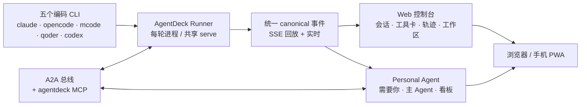

| 引擎 | 实况通道 | 会话 id | 历史回放来源 |
|---|---|---|---|
| `claude` | 每条消息一个 `claude -p --output-format stream-json --verbose [--resume <sid>] [--model <m>]` 进程，prompt 走 stdin | uuid | `~/.claude/projects/**/<sid>.jsonl` |
| `opencode` | 共享长驻 `opencode serve`：HTTP 建会话 / 发 prompt，`/event` SSE 取事件（**不是** `opencode run`） | `ses_…` | `opencode export <sid>` |
| `mcode` | `mcode exec --output-format stream-json [--session <mvs_…>] [--model <p/m>] [--effort <l>]` | `mvs_…` | `~/.minimax/v2/sessions/**/messages.jsonl` |
| `qoder` | `qoderclicn -p --output-format stream-json [--resume <sid>] [--model <m>] [--reasoning-effort <l>]`（没有 `--verbose`） | uuid | `~/.qoder-cn/projects/**/<sid>.jsonl` |
| `codex` | `codex exec --json [resume <sid>] [-m <m>] [-c model_reasoning_effort=<l>]`，prompt 走 stdin | thread uuid | `$CODEX_HOME/sessions/**/rollout-*-<sid>.jsonl` |

五个引擎的事件格式各不相同，但都经各自的适配层转成同一套 canonical 事件再渲染，所以工具卡片、轨迹视图、回放与实时的一致性在前端是共用一套逻辑。`qoder` 是 Claude Code 的 fork，事件格式与 transcript 布局都与 `claude` 同构（历史放在 `~/.qoder-cn` 下），因此两者共用适配层。

- **持久化边界**：AgentDeck 自己只落盘 `user`、`status`、`rewind` 三类事件；assistant / tool / thinking 等 stream 事件不落盘，每次 SSE 连接时从各引擎自己的 transcript 现场解析后合并回放。历史只有一份权威副本（在 CLI 那边），服务重启不丢，也不会出现两份互相打架的记录。回放只发尾部窗口，更早的事件按页拉。
- **续接**：claude / qoder 首轮从 `system/init` 捕获 session id，之后 `--resume`；opencode 建会话时拿到 `ses_…`，每轮在 prompt body 里带上当前 model / variant；mcode 用 `--session`；codex 用 `exec resume`。
- **停止**：claude / qoder / mcode / codex 杀掉当前进程组（启动时 `Setpgid`，杀整棵树）；opencode 调 serve 的 `interrupt` 接口。
- **轮次边界**：前四者以子进程结束或 `result` / `turn.completed` 为准；opencode 是共享长驻进程，靠 `/event` 的 `session.status`（busy → idle）关闭轮次，并有定时回查兜底。
- **回滚**：claude 默认注入 `CLAUDE_CODE_ENABLE_SDK_FILE_CHECKPOINTING=true`，每轮结束扫描 transcript 捕获该用户消息的 uuid（= 文件 checkpoint）写回事件；⏪ 时先 `--rewind-files` 恢复文件，再备份并截断 transcript 与事件日志。opencode 用自己的 revert 快照。回滚第一条消息后 transcript 变空，下一轮自动开新 session。
- **分叉**：claude / qoder 复制当前 transcript 成新会话；其余引擎没有可复制的独立 transcript，入口隐藏。

### 环境变量与推理档位

Claude Code 的 `~/.claude/settings.json` 的 `env` 段会覆盖进程继承的环境变量，所以只往进程注入 `ANTHROPIC_BASE_URL` 并不生效。AgentDeck 的做法：

1. 合并当前会话的生效 env（cli → provider → model，后者覆盖前者）。
2. 合并结果非空时，物化为 `data/settings/<cli>__<provider>__<model>.json`（0600），以 `--settings <绝对路径>` 传给 claude / qoder——命令行 settings 优先级最高。env 为空的 provider（端点由 CLI 自己提供）不物化也不传这个文件，否则命令会钉死在本机 data 目录的绝对路径上。
3. 同时把生效 env 注入进程环境，供其他 CLI 的兼容层使用。
4. **推理档位**：`CLAUDE_CODE_EFFORT_LEVEL` 会压过 `--effort`，所以会话指定的档位还会写进物化 settings 的 env（文件名带 `__effort-<level>`，不同档位不共用文件）。codex 走 `-c model_reasoning_effort`；opencode 走模型自身的 variant；qoder 走 `--reasoning-effort`；mcode 走 `--effort`。
5. opencode / mcode / qoder / codex 的凭据来自各自 CLI 的登录态或 `auth.json`，`config.yaml` 的 env 对它们不生效。codex 的封装版例外：一旦传了 `-c`，必须同时钉住 `model_provider`，否则它会退回官方端点。

### 可视化输出约定

服务端每轮向 system prompt 注入一段输出约定：完整报告 / 仪表盘优先发布成产物，聊天里只回链接和结论；小型图表才用 `html` 围栏；流程图 / 时序图仍用 `mermaid`。注入路径按引擎而异——claude / qoder / mcode 走 `--append-system-prompt`，codex 走 `-c instructions=<TOML 字符串>`，opencode 走它自己的 `instructions` 配置（AgentDeck 维护隔离的 OpenCode 配置目录，不碰用户全局规则）。`html_render_hint: false` 可整体关闭。

---

## 完整特性清单

<details>
<summary>展开全部 25 项能力</summary>

| 特性 | 说明 |
|---|---|
| 单二进制部署 | `go build` 生成一个可执行文件，前端资源已用 `go:embed` 打包，无需 Node 构建。 |
| 五引擎 | cli/provider 的 `kind` 选 `claude`（缺省）、`opencode`、`mcode`、`qoder` 或 `codex`，同一套界面里管理不同引擎的会话。会话绑定单一引擎，创建/修改/导入时 cli 与 provider 的 kind 必须一致。 |
| 多 CLI / Provider / Model | 配置文件定义多个 CLI 与 API 后端；会话内一键热切换 CLI、Provider、Model、权限模式与推理档位（opencode 的对应概念是 variant）。opencode / mcode / qoder / codex 的模型清单由各自 CLI 动态提供；opencode 里登录的 provider 还会被自动发现。 |
| Personal Agent | 设置 → 界面形态切到 Personal Agent：左栏主 Agent 头像 + worker，中栏需要你队列 / 主 Agent 会话 / 任务看板，右栏卡片优先详情与常驻 composer。权限门 / 提问 / 待人工 / 待验收统一成队列，worker 回报与看板工具调用自动折叠。 |
| 多 CLI 协作与 A2A | 五个引擎都能当主 Agent 或 worker，可以混用；`POST /api/a2a/send` 引擎中立，接收方不需要常驻。agentdeck MCP 给所有引擎注入 `send_message`、`new_session`、`read_session_messages`、`search_messages` 与看板工具；A2A 在对话流和轨迹里归入 A2A 角色。 |
| 导入已有会话 | 扫描各引擎自己的历史目录（`~/.claude/projects`、`~/.qoder-cn/projects`、opencode / mcode 的会话库、codex 的 rollout 目录），把本地历史会话一键接进 Web UI 继续聊。 |
| 回滚（rewind） | 每条带文件 checkpoint 的用户消息可 ⏪ 回滚。claude：CLI 恢复 Write/Edit 改过的文件、删除期间新建的文件，对话与 transcript 一并截断，消息文本回填输入框。opencode：走它自己的 revert 快照。Bash 改的文件不在 checkpoint 内。其余引擎隐藏入口。 |
| 流式实时对话 | SSE 推送，Markdown 渲染、代码高亮、工具调用折叠块、token 与花费统计、排队与停止。开 `partial_messages` 后支持打字机式逐 token 增量渲染。会话信息条显示轮数、步数、累计耗时与最近一轮 tok/s。 |
| 权限审批卡 | 非 bypass 的 claude/qoder 会话在工具调用前弹审批卡：允许本次 / 本次会话都允许（同名工具）/ 拒绝（可附理由），55s 超时自动拒绝。经 `--settings` 的 `PermissionRequest` hook 实现。opencode 的 `permission.asked` 与 `question.asked` 也映射到同一张卡；mcode 与 codex 没有审批面。 |
| 提问强提示 | 提问有 55s 硬超时，而卡片只停在当前会话。所以提问时另有顶部居中横幅、侧栏整行脉动、工作区栏「待回答 N」徽标——跨会话也能看见，点一下直达那张卡。 |
| 多 agent 群聊 | 一个群拉多个成员（各引擎通用），`@成员` 定向、`@all` 或空群发并行跑；成员是隐藏影子会话（点名直接打开看单独回放），群有独立 transcript 与时间线，审批卡照常弹。 |
| 常驻与跨会话消息 | A2A 总线对所有引擎可用；claude 还可选择常驻（streaming-input 进程跨轮次保持在线）并兼容 claude 原生 `SendMessage`。入站 A2A 以紫色 peer 气泡显示。 |
| 自动续跑目标 | 给会话挂一条达成条件，每轮干净结束后模型自评，未达标就自动再跑一轮，直到达标或触发轮数/时限熔断。条件可随时停止或清除；rewind 会清空目标。 |
| 工具调用可视化 | Bash 终端视图、Read/Write/Edit diff、TodoWrite 检查清单、thinking 折叠块、子代理折叠卡片。 |
| HTML / Mermaid 可视化 | `html` 围栏点「渲染」成沙箱 iframe，`mermaid` 围栏画成图并跟随深浅主题。iframe 不给 `allow-same-origin`，页面完全自包含。完整报告优先发布成产物，聊天里只回链接与结论。 |
| 会话分叉 | claude / qoder 可把当前 transcript 复制成新会话，从同一上下文另开一条分支（不动原会话）。 |
| 轨迹视图 | 会话内「轨迹」tab 把同一份事件流投影成按轮分组的台账：折叠/展开轮次、按角色筛选、关键词搜索，点开单条记录看 summary / preview / raw 三档详情。 |
| 使用统计 | 五个引擎的会话合并计数（页面上标出各自的会话数）：8 个指标 + GitHub 式热力图，按日按模型看 tokens 构成。增量缓存——首次全量扫描较慢，之后秒回。qoder 的 `usage` 不上报 token（计费走 credits），所以它的 token 类指标无意义，消息数/工具数/活跃天数仍准。 |
| 本地文件与图片预览 | 点击消息里的本地文件链接（如 `/path/to/file.md:12`）直接开右侧工作区面板并定位到那一行（工作区外退回旧的预览浮层）。模型回复里的 `` 经 `/api/image` 代理显示，同样限制在会话工作区内。 |
| 工作区面板 | 右侧文件区（照 Codex 桌面端布局）：文件树懒加载、可筛选、可只看有改动的文件；预览支持 Markdown、代码高亮、图片，带面包屑与「显示更改 / 查看源代码 / 刷新 / 用系统默认程序打开」。全部路径严格限制在当前会话的工作区内。 |
| 全局待办备忘 | 与单个会话无关的 checklist，存在服务端 `data/notes.json`，换设备 / 重启都不丢。 |
| 任务完成通知 | 任务跑完（或出错）时弹系统横幅 + 提示音，点击直达对应会话。可在侧栏「设置」里分别开关，配置跟着浏览器走。 |
| TUI 与 Web 自由切换 | 每个会话都有 session id，点「resume」复制命令即可回到 TUI 继续跟进。 |
| 移动优先 PWA | 抽屉导航、底部操作面板、响应式布局、深浅主题切换，iOS 独立 PWA 避开状态栏安全区。 |
| 安全网关 | 单一 `gateway_token` 鉴权；文件、图片与工作区接口严格限制在会话工作区内。 |

</details>

---

## API 概览

<details>
<summary>展开接口列表</summary>

| 方法 | 路径 | 说明 |
|---|---|---|
| POST | `/api/login` / `/api/logout` | `{token}` 登录 / 退出 |
| GET | `/api/me` | 当前登录信息 |
| GET | `/api/clis` / `/api/providers` / `/api/profiles` / `/api/config` | 下拉与运行时配置（env 值不下发） |
| GET / POST | `/api/sessions` | 会话列表（含状态、待回答提问、resume 命令）/ 创建 |
| GET | `/api/needs-you` | Personal Agent「需要你」队列（权限 / 提问 / 待人工 / 待验收及计数） |
| GET | `/api/agent-board` / `/api/agent-board/events` | 看板快照 / 变更 SSE |
| POST | `/api/agent-board/tasks/{id}/events` | 追加看板任务时间线 |
| POST | `/api/a2a/send` | 引擎中立跨会话消息 `{from,to,message,send_id?}` |
| GET / PATCH / DELETE | `/api/sessions/{id}` | 详情 / 改名·换 profile·model·档位·权限·常驻·地址名 / 删除 |
| POST | `/api/sessions/{id}/messages` | 发送消息 `{text, images, files}` |
| POST | `/api/sessions/{id}/uploads?name=` | 上传附件（落盘后经消息文本引用，同名文件不覆盖） |
| POST | `/api/sessions/{id}/stop` | 中断当前轮 |
| PUT / DELETE | `/api/sessions/{id}/goal` | 设置自动续跑目标 / 清除 |
| POST | `/api/sessions/{id}/fork` | 分叉会话（claude / qoder） |
| POST | `/api/sessions/{id}/rewind` | 回滚到某条用户消息 `{checkpoint}`（claude / opencode） |
| POST | `/api/sessions/{id}/permissions/request` | 审批 helper 上报工具调用（阻塞等决策） |
| POST | `/api/sessions/{id}/permissions/{pid}` | 审批决策 `{behavior: allow\|allow_tool_session\|deny, message?}` |
| GET | `/api/sessions/{id}/permissions/pending` | 未决审批列表（重连补卡） |
| GET | `/api/sessions/{id}/events` | SSE：历史回放 + 实时事件 |
| GET / POST | `/api/groups` | 群列表 / 建群 `{name, cwd, members[]}` |
| GET / DELETE | `/api/groups/{id}` | 群详情＋transcript / 解散群聊 |
| PATCH | `/api/groups/{id}/members/{memberId}` | 改单个成员档案（下轮生效） |
| POST | `/api/groups/{id}/messages` | 群发消息（`@成员` / `@all`，忙时 409） |
| POST | `/api/groups/{id}/stop` | 停本轮（全员） |
| GET | `/api/groups/{id}/events` | SSE：群回放＋实时事件 |
| GET | `/api/claude-sessions(+preview)?cwd=` | 扫描本机 `~/.claude/projects` |
| GET | `/api/qoder-sessions(+preview)?cwd=` | 扫描本机 `~/.qoder-cn/projects` |
| GET | `/api/opencode-sessions(+preview)?cli=&cwd=` | 扫描 opencode 会话（cwd 空 = 跨项目枚举） |
| GET | `/api/mcode-sessions(+preview)?cli=&cwd=` | 扫描 mcode 会话 |
| GET | `/api/codex-sessions(+preview)?cli=&cwd=` | 扫描 codex 的 rollout 目录 |
| GET | `/api/opencode-models?cli=&provider=` | opencode 可用模型 + 输入模态（10 分钟缓存，后台刷新） |
| GET | `/api/opencode-model-variants?cli=&provider=` | opencode 每个模型可用的 variant（与上一项共用一次 CLI 调用） |
| GET | `/api/mcode-models?fresh=` | mcode 可用模型 + 推理档位 + 输入模态 |
| GET | `/api/qoder-models?cli=&provider=` | qoder 可用模型 + 推理档位（10 分钟缓存） |
| GET | `/api/codex-models?cli=&provider=` | codex 可用模型 + 推理档位 + 输入模态（10 分钟缓存） |
| POST | `/api/sessions/import` | 导入已有 session（按 cli 的 kind 决定读哪个引擎的历史） |
| GET | `/api/stats?fresh=1` | 五引擎合并使用统计（默认走增量缓存） |
| GET / PUT | `/api/notes` | 全局待办备忘（前端全量覆盖写） |
| GET | `/api/files?path=` | 读取本地文件（限会话工作区内） |
| GET | `/api/image?path=` | 读取本地图片（限会话工作区内） |
| GET | `/api/sessions/{id}/workspace/tree?path=` | 工作区面板：列一层目录（`path` 相对会话 cwd） |
| GET | `/api/sessions/{id}/workspace/file?path=` | 工作区面板：读一个文件 |
| GET | `/api/sessions/{id}/workspace/status` | 工作区面板：git 改动清单（给文件树打标记） |
| GET | `/api/sessions/{id}/workspace/diff?path=` | 工作区面板：某个文件的 git diff（未跟踪文件按新增返回） |
| POST | `/api/sessions/{id}/workspace/open` | 工作区面板：用系统默认程序打开文件 `{path}` |

</details>

---

## 安全边界

- **鉴权**：所有 API 与 SSE 接口都需要 `gateway_token`，支持 `Authorization: Bearer <token>` 或 `?token=` 查询参数；比较用常量时间算法。
- **文件与图片**：`/api/files` 只允许读**位于任一会话工作区（cwd）内**的文件，并 `EvalSymlinks` 解析真实路径，防软链接与 `..` 穿越；只读、上限 2 MiB、拒二进制。`/api/image` 是它的孪生口子，额外要求扩展名在图片白名单（不含 svg）、≤10 MiB、带 `nosniff`。
- **工作区面板**：比 `/api/files` 更严——锚在**当前会话**的 cwd，只收相对路径，`..` 段、绝对路径与符号链接逃逸一律拒绝。`open` 是唯一有副作用的接口，只由用户点按钮触发。
- **上传图片**：`/api/sessions/{id}/uploads/{name}` 只服务**本会话**的上传目录，文件名去分隔符、`EvalSymlinks` 后仍须在目录内，同样走图片白名单与 10 MiB 上限。
- **HTML 沙箱**：渲染 iframe 不带 `allow-same-origin`，页面碰不到宿主 DOM、localStorage 或带凭据的同源接口。
- **凭据**：`data/settings/*.json` 含端点凭据，权限 0600，env 值不下发前端；公开分享的产物只存 token 哈希。
- **提醒**：`gateway_token` 请设成强随机字符串，别把端口直接暴露在公网，建议通过反向代理或 VPN 访问。

---

## 部署到其他机器

```bash
# 交叉编译（例如在 macOS 上编给 Linux）
GOOS=linux GOARCH=amd64 go build -o agentdeck .

# 拷二进制 + 一份 config.yaml 过去即可，无运行时依赖
scp agentdeck config.yaml user@remote:~/
ssh user@remote 'GATEWAY_TOKEN=xxx ./agentdeck'
```

---

## FAQ

<details>
<summary>需要先装哪些 CLI？</summary>

至少一个受支持的 CLI（claude / opencode / mcode / qoder / codex），AgentDeck 是这些 CLI 的控制层，不代替它们，也不需要额外的运行时。装几个就能用几个引擎，`config.yaml` 里没声明的不会出现在下拉里。

</details>

<details>
<summary>能在公网或手机流量下用吗？</summary>

可以，但请走反向代理或 VPN。鉴权只有单一 `gateway_token`，没有账号体系，直接把端口暴露在公网，等于把机器上的文件和 CLI 权限一起交出去。移动端本身没问题：PWA 加到主屏后是独立窗口，会避开状态栏安全区。

</details>

<details>
<summary>和我在终端里的 TUI 会打架吗？</summary>

它们共用同一份会话与 transcript：Web 里跑过的轮次，回 TUI `--resume` 就能看到，反之亦然。但不要在两边同时对**同一个会话**发消息——两轮并发写同一份 transcript，历史会错乱。并行请开不同会话。

</details>

<details>
<summary>主 Agent 和 worker 必须用同一个引擎吗？</summary>

不必。A2A 是引擎中立的：地址名与投递走 `/api/a2a/send`，接收方不需要常驻，也不依赖 claude 的 `SendMessage`。独有能力分别是：常驻进程与原生 peer 消息只属于 claude；文件 checkpoint 回滚是 claude / opencode；分叉是 claude / qoder。

</details>

<details>
<summary>为什么 qoder 的 token 统计是 0？</summary>

qoder 的 `usage` 各字段恒为 0，计费走 `credits` / `billable` 字段（`billable:false` 即免费模型）。所以它的消息数、工具数、活跃天数都准，token 类指标对它没有意义。要按额度统计得另开一个维度。

</details>

<details>
<summary>模型列表为什么是空的？</summary>

非 claude 引擎的模型由 CLI 现问，配置里 `models: []` 是**正确写法**。下拉为空通常是 CLI 没登录、二进制路径不对，或该 provider 没有可用模型——直接在终端跑一次对应命令（如 `opencode models`、`qoderclicn --list-models`）就能定位。

</details>

---

## 文档

- 使用与开发约定：[AGENTS.md](AGENTS.md)
- 主 Agent 派工与 worker 回报：[docs/main-agent-best-practices.md](docs/main-agent-best-practices.md)
- Personal Agent「需要你」队列：[docs/needs-you-rd.md](docs/needs-you-rd.md)
- A2A 总线与 agentdeck MCP：[a2a-rd.md](a2a-rd.md)
- 常驻与 peer messaging：[peer-rd.md](peer-rd.md)
- rewind 设计与实施：[rewind-rd.md](rewind-rd.md)
- 浏览器 PoC：[docs/browser-poc.md](docs/browser-poc.md)
- 版本变更：[CHANGELOG.md](CHANGELOG.md)、[Releases](https://github.com/yhx5768/AgentDeck/releases)

---

## 项目结构

<details>
<summary>展开目录说明</summary>

```
main.go                  # 入口 + go:embed
internal/config/         # 配置加载 + 热加载
internal/store/          # 会话元数据、事件日志、目标、备忘持久化
internal/runner/         # CLI 进程管理：队列、流解析、事件广播、停止、常驻、目标
internal/server/         # HTTP 路由、鉴权、SSE、群聊、统计、文件/图片、看板
internal/claudehist/     # ~/.claude 与 ~/.qoder-cn 的 projects 扫描、导入转换、统计
internal/opencodehist/   # opencode 引擎适配：事件转换、export 回放、模型变体、统计
internal/opencodeapi/    # opencode serve 客户端：HTTP + SSE、权限/提问回复、revert
internal/opencodev2/     # OpenCode 2 的读取层与实况客户端
internal/opencodever/    # opencode 二进制主版本探测（v1 / v2 分派）
internal/mcodehist/      # mcode 引擎适配：stream-json 事件转换、transcript 回放、模型目录、统计
internal/codexhist/      # codex 引擎适配：exec --json 事件转换、rollout 回放、模型目录、统计
internal/browser/        # 浏览器 PoC：本地 Chrome 生命周期、CDP 动作与 MCP 工具面
internal/statsagg/       # 五引擎共用的统计聚合核心
internal/a2a/            # 引擎无关注跨会话消息：信封、agentdeck MCP 工具面、A2A 投递
internal/boarddb/        # SQLite 看板：任务、时间线、产物、worker 绑定、公开分享
scripts/                 # 一键安装脚本（README 的 curl | bash 指向 install-agentdeck.sh）、前端 jsdom 测试
docs/needs-you-rd.md     # Personal Agent「需要你」队列设计
web/                     # 免构建前端（vanilla JS + vendor 的 marked/DOMPurify/highlight.js/mermaid）
web/agent*.js            # Personal Agent：队列、右栏、折叠、作答路径
```

</details>

---

## 反馈与贡献

遇到问题或有新功能建议，欢迎提交 Issue 或 PR。改动前建议先读 [AGENTS.md](AGENTS.md)，里面记了各引擎的协议差异、几个容易踩回去的坑，以及测试怎么跑：

```bash
go test ./... && go vet ./...
./scripts/frontend-tests/run.sh
```

---

*AgentDeck 是一个社区驱动的多引擎 AI 编码 Web 控制层，不是 Anthropic 官方产品。*
