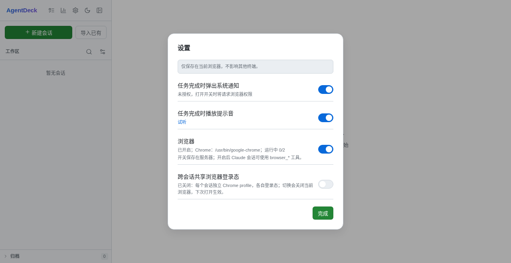
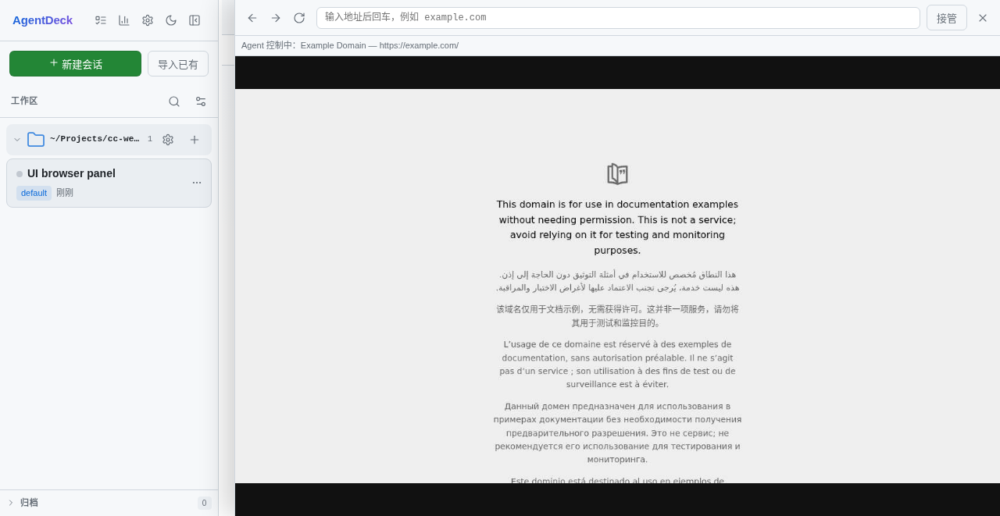

# 浏览器 PoC（browser-poc 分支）

> 状态：PoC，未合入 master。目标是把 OpenMausBot 的“Agent 用浏览器 + 人看实时画面/接管”这套能力，按 AgentDeck 的 Go 单二进制 + MCP 架构做一个最小验证。

## 已实现

- 设置页新增「浏览器」开关，服务端持久化到 `<data_dir>/browser/settings.json`。
- 开启时检测本机 Chrome/Chromium：
  - macOS：`/Applications/Google Chrome.app/...`、`~/Applications/...`、Chromium。
  - Linux：`google-chrome`、`google-chrome-stable`、`chromium`、`chromium-browser`、`/snap/bin/chromium`。
  - Windows：`Program Files` / `Program Files (x86)` 下的 Chrome/Chromium。
  - 也支持 `browser.chrome_path` 显式指定。
- 找不到 Chrome 时弹窗询问是否安装：
  - macOS 且找到 Homebrew：用户确认后执行 `brew install --cask google-chrome`，可用 `brew uninstall --cask google-chrome` 回退。
  - Linux/Windows 或没有 Homebrew：只展示官方下载地址/安装命令，不代跑 `sudo` 或交互式安装器。
  - 用户拒绝则保持关闭并显示原因。
- 浏览器运行时：
  - 默认每个 AgentDeck session 一个 Chrome 进程和一个 `user-data-dir`，登录态跨轮次保留。
  - 共享开关开启时只有一个 Chrome 进程/一个 shared profile，每个 session 一个 target/window；cookie/localStorage 共享，窗口之间互不关闭，最多 `browser.max_windows` 个。
  - 最大并发 `browser.max_browsers`（默认 2，per-session 模式），空闲 `browser.idle_minutes`（默认 10）关闭。
  - 浏览器帧走独立 `GET /api/sessions/{id}/browser/stream` SSE，不进入会话事件流。
  - 人工接管/交还走 `POST /api/sessions/{id}/browser/input`；接管期间 agent 工具被拒绝。
- Claude 通过 MCP 使用：
  - runner 在开启浏览器时生成 `data/browser/mcp/<session>.json`（0600），以 `--mcp-config` 注入。
  - `cc-webui -browser-mcp` 是 stdio MCP 代理，转发到 loopback-only 的 `/api/internal/browser/mcp`。
  - 工具：`browser_status/open/navigate/snapshot/read/screenshot/click/fill/type/press/wait/close/restart`。
- 安全：
  - 只允许 `http`/`https`/`about:blank`，拒绝 `file:`、`javascript:`、`chrome:`、`data:`。
  - 默认拒绝 localhost/内网/link-local/云 metadata；`browser.allow_local` 或 `browser.allow_hosts` 才能放行。
  - 始终拒绝 AgentDeck 自己的 listen 端口。
  - snapshot 不返回 password 字段的值（显示 `[value masked]`）。
  - MCP 配置和 settings 文件 0600；日志不打印 token。
  - 输入接口要求同源；内部 MCP 接口只接受 loopback + Bearer token。反代场景可用显式 `browser.trusted_origins`，或确认反代覆盖 `X-Forwarded-*` 后开启 `browser.trust_forwarded_headers`。

## 截图

设置开关（Chrome 已检测，开关打开）：



浏览器面板（左侧 AgentDeck，右侧实时画面 + 地址栏 + 接管）：



## 配置

`config.example.yaml` 增加了注释块：

```yaml
browser:
  enabled: false
  chrome_path: ""
  max_browsers: 2
  max_windows: 4
  idle_minutes: 10
  fps: 8
  quality: 60
  allow_local: false
  allow_hosts: []
  trusted_origins: []
  trust_forwarded_headers: false
```

运行时开关由设置页写 `<data_dir>/browser/settings.json`，优先于 `browser.enabled`。

`browser.trusted_origins` 只在反向代理改写了 Host、又没透传 `X-Forwarded-Host`/`X-Forwarded-Proto` 时使用；优先修反代。输入接口默认接受三种来源：

1. `Origin` 与请求 `Host` 同源；
2. `Origin` 命中 `browser.trusted_origins`；
3. 显式开启 `browser.trust_forwarded_headers` 后，请求来自 loopback（本机反代），且 `Origin` 与 `X-Forwarded-Host`/`X-Forwarded-Proto` 一致。该开关默认关闭，因为 nginx 默认会把客户端自带的 `X-Forwarded-*` 原样转发，开启前必须确认反代会覆盖这些头。

## 使用

1. 构建：`go build -o cc-webui .`
2. 启动：`./cc-webui -config <config.yaml>`
3. 设置 → 浏览器 → 打开开关；Chrome 已安装时会做一次 30 秒内的启动探针。
4. 打开一个 Claude 会话，直接说“用 browser 工具打开 https://example.com 并告诉我标题”。
5. 右上角地球图标打开浏览器面板；点「接管」后可以自己点击/输入，点「交还」恢复 agent 控制。

MCP 配置只注入 Claude/qoder 这一类支持 `--mcp-config` 的引擎；codex/opencode/mcode 尚未接入，UI 不区分引擎，后续按引擎能力显示。

## 测试记录（2026-11-02，本机）

- `go build -o cc-webui .`：通过。
- `go vet ./...`：通过。
- `go test ./... -count=1`：`internal/browser`、`server`、`store`、`config` 等通过；`internal/runner` 的 `TestServeKeyIsCompact` 失败（master 基线同样失败，和本改动无关）。
- 隔离实例（127.0.0.1:18821，临时 data_dir）实测：
  - 设置开关开/关、Chrome 检测、状态回读通过。
  - `tools/list` 返回 13 个工具；`browser_open https://example.com` 返回标题和快照。
  - 本地测试页：`browser_fill #name` → `browser_click #go` → `browser_read #out` 得到 `Hello, Ada`。
  - `browser_screenshot` 返回 PNG（约 100 KB base64）。
  - SSE 连续收到 JPEG 帧；浏览器面板截图见上。
  - 人工接管时 `browser_snapshot` 返回“已被人工接管”，交还后恢复。
  - 并发第 3 个会话得到“浏览器并发已达上限”。
  - `file:///etc/passwd`、`169.254.169.254`、`100.100.100.200`、AgentDeck 自己的端口均被拒绝。
  - `browser_restart` 可用；密码字段 snapshot 显示 `[value masked]`，不泄露值。
  - 修复后回归：SSE 打开时输入 `https://www.baidu.com/`，take/navigate 200，SSE 继续出帧；agent `browser_open` 在 SSE 打开时正常。
- Claude Code 2.1.226 真实会话实测：`browser_status` MCP 工具被调用并返回 `running=true` 等原文。

## 登录态与 profile（2026-11-02）

默认每个 AgentDeck session 一个 Chrome profile（`browser/profiles/<session-id>`）。`browser_close` 会保留该 profile 的 cookie，同一个 session 再打开仍登录；但切换到另一个 AgentDeck session 会使用新的 profile，看起来就像“登录没保存”。

设置页新增「跨会话共享浏览器登录态」开关，**默认关闭**：

- 关闭：每个 session 独立 Chrome profile，各自登录态。18821 的 demo session 用 `profiles/4c97…`，可打开 CR `123088562`。
- 开启：所有 session 使用同一个 shared profile，名字取 `browser.profile_key`（默认 `user`），路径 `browser/profiles/shared-<key>`。所有 session 共用一个 Chrome 进程，但各自有独立的 target/window；cookie/localStorage 在同一 profile 内共享，最多 `browser.max_windows`（默认 4）个 session 窗口。关闭一个窗口不影响其他窗口，最后一个窗口关闭后才回收 Chrome。
- 切换开关会关闭当前浏览器，**下次打开生效**，避免已打开浏览器还停在旧 profile；状态持久化在 `data/browser/settings.json` 的 `shared_profile`，默认 `false`。
- `browser.profile_key` 只给 shared profile 命名，本身不启用共享；是否共享由设置开关决定。

18821 验证：

1. 默认关闭：demo 用 `profiles/4c97…` 打开 CR，登录态正常。
2. 开启共享：demo 改用 `profiles/shared-user` 打开 CR，登录态正常。
3. 两个会话同时开启共享 profile：各自独立 target/window，第二会话不再被 busy 拒绝；关闭第一会话只关它的窗口，第二会话继续可用，关闭最后一个才回收 Chrome。隔离实例 18829 已验证 cookie/localStorage 共享、SSE 双路出帧、按 target 接管、逐窗口关闭。
4. 再关闭共享：第二会话改用 `profiles/<第二会话 id>` 打开 CR，跳到 UUAP 登录页，证明按 session 隔离恢复。
5. 最终预览保持开关关闭；`shared-user` 登录态保留，用户需要跨会话复用时再打开开关即可。

迁移旧登录态到 shared profile：先关闭浏览器/服务，把 `browser/profiles/<旧 session>` 复制到 `browser/profiles/shared-<key>`，开启设置开关后重启/重开浏览器。共享 profile 是登录态便利选项，不是多用户隔离。

## 崩溃修复（2026-11-02）

用户反馈在浏览器面板输入网址后卡住。现场：`cc-webui-browser-poc.service` 仍 active、无 panic、Chrome 子进程仍在。

根因：`Manager.Input` / `Manager.Execute` 在调用 `chromedp.Run` 时持有 `Session.mu`；`Session.onEvent` 处理 `Page.screencastFrame` 时同步获取同一把锁。CDP 动作在等响应，而 chromedp 的事件循环被 `onEvent` 的 `Mutex.Lock` 阻塞，形成死锁。SIGQUIT goroutine dump 显示 `Manager.Input.Navigate.responseAction` 停在 `chromedp.Run`，`Session.onEvent` 停在 `sync.Mutex.Lock`。

修复：新增 `Session.actionMu` 串行化 CDP 动作；`Session.mu` 只保护短状态和订阅者；`updatePage` 只在写入字段时短暂加锁；导航/截图/点击等动作加 5–30 秒超时。这样 screencast 事件不再被动作锁挡住。

回归：面板 SSE 打开时输入 `https://www.baidu.com/`，`take` + `navigate` 返回 200，SSE 持续出帧；agent 在 SSE 打开时执行 `browser_open` 也正常。修复提交见本轮回报。

## SSE 订阅二次 close 修复（2026-11-02）

用户用 `icode.baidu.com` 扫码登录后白屏，面板一直显示「浏览器连接断开，正在重连…」。服务仍 active，日志有 panic：

```text
http: panic serving ...: close of closed channel
internal/browser.(*Session).Subscribe.func1.1() manager.go:462
internal/server.(*Server).handleBrowserStream() browser.go:185
```

根因：`Session.close` 关闭所有 viewer channel 并清空 map；SSE handler 的 `defer unsub()` 又无条件 `close(ch)`。浏览器关闭/重连与 SSE 断开竞态时，同一个 channel 被关两次，panic 按 SSE 连接触发，前端于是不断重连。

修复提交 `ce0701f`：`unsub` 只在 channel 仍在 map 里时关闭（`close` 和 `unsub` 都持 `Session.mu`）；`Subscribe` 遇到已关闭 session 返回已关闭 channel，handler 立即退出。新增 3 个回归测试覆盖 close+unsub、unsub+close、subscribe-after-close。

回归：打开 `https://icode.baidu.com/` 的 UUAP 扫码页并保持 SSE 面板，执行 5 轮 browser close/open + SSE 断开/重连，无 panic，服务 PID 不变；扫码本身需要用户账号，未在自动化里完成。

## 多引擎 MCP 接入（2026-11-02）

| 引擎 | 注入方式 | 状态 |
|---|---|---|
| Claude / Qoder | 每会话 `--mcp-config <0600 json>` | 已验证，原有路径不变 |
| Codex / ducx | `-c mcp_servers.browser.*`；token 不放在 argv，改用 0700 wrapper + 0600 env 文件 | 已实测 `browser_status` 返回 running/URL/control |
| OpenCode v2.1.4 | 每会话 `OPENCODE_CONFIG_DIR` 下的 `opencode.json`，`mcp.servers.browser`；浏览器会话使用独立 serve 进程 | 已实测 `browser_status` 返回 running/URL/control |
| mcode 0.7.0 | `exec` 只自动加载 session cwd 的 `.mcp.json`；ACP 可按会话传 mcpServers，但 AgentDeck 未接 ACP | 未接入；不写用户仓库，因此本 PoC 的 mcode 无 browser_* 工具 |

Codex 细节：`-c` 的值会出现在进程 argv，所以不能把 token 放进 `mcp_servers.browser.env`。现在生成 `data/browser/mcp/codex/<session>.sh`（0700）和 `<session>.env`（0600），wrapper 读取 env 后 exec `cc-webui -browser-mcp`；argv 只有 wrapper 路径。实测 `ducx mcp list` 能看到 browser，真实会话调用 `browser_status` 成功。

OpenCode 细节：`opencode serve` 是长驻进程、配置在启动时读取，不能把不同会话的 MCP env 混在同一个 serve 里。浏览器开启时，`serveKey` 加入 session id，`OPENCODE_CONFIG_DIR` 指向 `~/.config/cc-webui/opencode/sessions/<session>/`，该目录的 `opencode.json` 含 `instructions` 和 `mcp.servers.browser`，文件 0600；非浏览器会话仍共用原 serve。实测真实会话调用 `browser_status` 成功。

mcode 0.7.0 的 `exec` 只读取会话主工作目录的 `.mcp.json`；AgentDeck 不向用户仓库写文件，所以没有安全的 per-session 注入点。mcode ACP 协议有 per-session `mcpServers`，但当前 AgentDeck 的 mcode 引擎走 `exec`，本 PoC 不切换；后续可评估 ACP 或显式 opt-in 的 `.mcp.json`。


- 单标签页；没有多 tab、frames/shadow DOM 完整支持、dialog、下载、上传、文件选择器。
- 没有真正的出口代理（SOCKS5/HTTP CONNECT）；目前是导航前 URL 解析 + 私网/metadata 拦截，挡不住已打开页面里的子资源请求直连内网。产品化前应补浏览器级 egress gate（参考 OpenMausBot `server/browser/egress/`）。
- MCP 配置里目前放的是 gateway token（0600 文件，仅 loopback 使用）；产品化建议改成 per-session capability。
- 浏览器开关对已存在的常驻进程不即时生效；需要重启常驻或下一轮 spawn。
- macOS 自动安装只在有 Homebrew 时执行；Linux/Windows 只给命令/URL。
- 只有 Claude/qoder 路径注入 `--mcp-config`；codex/opencode/mcode 未接。
- 没有浏览器证据（步骤截图/页面健康）、没有登录库/1Password、没有 My Chrome 附着。
- 没有移动端适配；面板是桌面优先。
- 没有清理 profile 目录的 UI；删除 session 会关闭浏览器并删 profile 目录。
