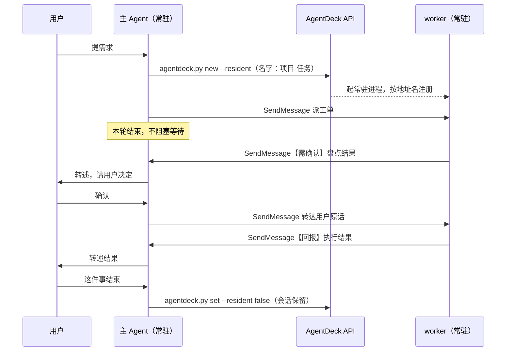

# 主 Agent 派工最佳实践

> 场景：用户只跟一个常驻主 Agent 对话。主 Agent 按任务新建常驻 worker 会话去执行，worker 用 Claude Code 内置的 `SendMessage` 回报。
> 依据：`internal/runner/resident.go`、`internal/server/server.go`、`web/app.js`、`skills/agentdeck/` 的实现，以及 2026-10-30 的实际运行与冒烟测试（见文末）。常驻进程与地址名的机制设计见 `peer-rd.md`，命令全集见 `skills/agentdeck/SKILL.md`。

## 1. 要解决的问题

同一个项目开了好几个会话，A 会话跟进一部分，B 会话跟进另一部分，时间一长就分不清哪件事在哪个窗口、做到了哪一步。这套做法把入口收成一个：用户只跟主 Agent 说话，每件事交给一个单独的 worker 会话执行，worker 做完回报主 Agent。worker 会话一直留在侧栏里，用户随时能点开看执行过程。

## 2. 角色与分工

| 角色 | 数量 | 职责 | 常驻 |
|---|---|---|---|
| 主 Agent | 1 | 接需求、建 worker、派工、转述回报、记录用户决策、收尾 | 开，地址名固定（例如 `mainAgent`） |
| 任务 worker | 一件事一个 | 执行这件事，做完、需要决定或卡住时回报 | 开 |
| 项目常驻 worker（可选） | 每个项目最多 1 个 | 需要长期上下文的运维类工作，同一项目的新活优先派给它 | 开 |

- 主 Agent 自己不跑长任务。peer 消息要等接收方下一次工具调用才会进上下文，主 Agent 卡在长命令里时，回报就进不来（冒烟中一条回报因此晚了 2.5 分钟才被看到）。派完工就结束本轮。回报到达时 CLI 会为它开新一轮，cc-webui 在 `procOnPeerMessage` 里把这一轮标成运行中。
- worker 只由主 Agent 建。worker 之间不互相派工，需要拆分时在自己会话里用子 agent。这样所有线索都汇到主 Agent 一处。
- 建新 worker 前，先用 `agentdeck.py ls` 看同一件事有没有还开着的 worker，有就把后续发给它。
- 用户也可以直接在某个 worker 会话里说话。worker 处理完照样回报主 Agent（派工单里写明），主 Agent 那边的记录才完整。

主 Agent 本身这样建。地址名定下后不要再改，所有 worker 都按这个名字回报：

```bash
AD=~/.claude/skills/agentdeck/scripts/agentdeck.py
$AD new --name "主Agent" --peer-name mainAgent --resident \
  --cli ducc --provider ducc-models --model <模型> --effort <档位> \
  --cwd <记录所在的工作区>
```

一件事的完整流程：



## 3. 建 worker

### 3.1 默认配置

| 项 | 默认值 | 说明 |
|---|---|---|
| 引擎 | `--cli ducc --provider ducc-models` | **常驻进程**只有 claude 内核（ducc、claude）支持，其他引擎带 `--resident` 会被服务端 400；但**跨会话消息（A2A）已引擎中立**——worker 与主 Agent 不一定是 claude，投递走 `/api/a2a/send`（见 `a2a-rd.md`） |
| 模型 | `--model DeepSeek-V4.1-Flash` | 写模型目录里的原样 ID，大小写敏感。服务端 `modelKnown` 只认 config.yaml 里登记的名字或 `ducc models` 输出的 ID，都是精确匹配；写成 `deepseek-v4.1-flash` 两边都没有，返回 400 `unknown model` |
| 档位 | `--effort max` | claude 内核的固定档位之一（low / medium / high / xhigh / max） |
| 常驻 | `--resident` | 必开。不开常驻的会话只在跑某一轮时临时注册，用的还是派生名，按地址名发 `SendMessage` 发不到它 |
| 名字 | `--name` 和 `--peer-name` 都写 `项目-任务` | 见 3.2 |
| 工作目录 | `--cwd <任务所在的仓库或工作区>` | 决定 worker 读哪份 CLAUDE.md、触发哪些 hooks。侧栏按目录分组，worker 显示在对应目录下 |
| 权限模式 | 不传，继承 cli 配置 | 和主 Agent 保持一致，见 3.4 |

模型目录会变。换模型前先跑 `$AD models --cli ducc --provider ducc-models` 查当前 ID，再用 `$AD efforts --cli ducc --provider ducc-models --model <ID>` 查可用档位。

### 3.2 命名：项目-任务

会话名用 `项目-任务`，例如 `cc-webui-修SSE断线`、`周报-整理本周进展`，地址名写同一个值。

- 同时传 `--peer-name`，地址就和显示名脱钩。不传时 `effectivePeerName` 取清洗后的会话名作地址，用户之后在侧栏改了名，下次进程重启（服务重启、重开常驻）地址就跟着变，主 Agent 再按旧名发会失败。
- 项目部分固定一种写法，同一项目的 worker 共用前缀。侧栏搜索框按名字过滤，搜前缀就能列出这个项目的全部 worker。
- 地址名规则（`CleanPeerName`）：去掉换行等控制字符（制表符保留）和首尾空白，不能以 `/` 开头，超过 80 个字符截断，可以用中文。另外别用空格和方括号，`SendMessage` 用 `名字 [ref]` 的写法区分同名会话。
- 在线会话之间不要重名。按 `peer-rd.md` §2.2，同机在线会话撞名时，后启动的拿到带后缀的变体名，`get` 的 status 里显示的就是实际注册名。同一件事要重做时加后缀，例如 `cc-webui-修SSE断线-2`。关了常驻的会话没有常驻进程，不再长期占用这个名字。

### 3.3 建完确认在线

```bash
SID=$($AD new --name "cc-webui-修SSE断线" --peer-name "cc-webui-修SSE断线" --resident \
  --cli ducc --provider ducc-models --model DeepSeek-V4.1-Flash --effort max \
  --cwd ~/Projects/cc-webui)
$AD get "$SID" | grep -E '^(resident|status) '
```

`new` 的 stdout 只有会话 id，提示信息走 stderr。服务端建完立即调 `EnsureResident` 起进程。起进程失败时它只记日志、照常返回会话（`handleCreateSession` 这样做，是为了不让调用方误以为没建成而重试出重复会话），所以建完要看一眼状态：

| `get` 显示 | 含义 |
|---|---|
| `resident : True`，`status : resident:<名字>` | 进程在线，冒号后是注册表里的实际地址 |
| `status : resident`（后面没有名字） | 进程起了，注册还没读到，过几秒再看 |
| `resident : True`，`status` 里没有 `resident` | 设置开着、进程没起来或已退出，用 `$AD set "$SID" --resident true` 重新拉起 |

冒烟测试中，worker 进程在建会话后约 1 秒就按地址名注册（注册表里 `startedAt` 和 `nameSince` 相差 1 毫秒）。派工以 `ListAgents` 列出的名字为准。

### 3.4 权限模式保持一致

worker 不单独传 `--permission-mode`，继承 cli 配置（例如 config.yaml 里 `ducc` 配成 `bypassPermissions`），和主 Agent 相同。原因：

- cc-webui 只在物化 `--settings` 文件时写入 `crossSessionInbound: "accept"`。provider 没有 env、也不需要审批 hook 时不生成这个文件（`spawnResident` 里的 `needsSettings`），入站消息按 CLI 默认策略处理。`ducc-models` 就属于这种情况：实测当前三个 ducc-models 常驻进程的启动参数里都没有 `--settings`（`data/settings/` 里那几个 `ducc__ducc-models__*` 文件是 09-29 旧版本留下的）。
- CLI 2.1.258 的 `SendMessage` 返回值写着："It is delivered to you if that session runs in the same permission class as this one (or is one this session spawned); otherwise it is only logged here (this session holds other inbound peer traffic)"。按这段说明，权限类不同的会话之间，空闲通知只记日志，其他入站消息也可能被扣住。
- 实测主 Agent 和 worker 都用 `bypassPermissions` 时，派工、回报、空闲通知都能送达。

`bypassPermissions` 下 worker 不会弹权限确认，安全边界靠派工单里的「不许做」和第 5 节的确认流程。

## 4. 派工

### 4.1 用 SendMessage 发派工单

派工、追问、转达确认都用**跨会话消息**，不用 `agentdeck.py send`。**首选 agentdeck 的 MCP 工具 `send_message`**（所有引擎都注入，`from` 填自己的地址名）；claude 引擎也可用内置 `SendMessage`。两者到达时都带发送方的地址名，接收方知道是谁派的活、也不会当成用户本人的指令。`agentdeck.py send` 写入的是一条普通 user 消息，在接收方看来就是用户亲手输入的（所以默认不给主 Agent 用）。

```text
【派工】<项目-任务>，来自 <主 Agent 地址名>
你的会话 id：<AgentDeck 会话 id>（起后台脚本时用来回调，见第 7 节）
任务：<一两句话>
用户原话：「<用户怎么说的>」
完成标准：<可检查的结果：输出哪些数据、改完哪些文件、哪条命令退出码为 0>
不许做：<范围外的事>；不可逆操作（停服务、删数据、提 CR、对外发消息）先盘点回报，等确认
提问：有问题用【需确认】回报，不要用 AskUserQuestion，用户一般不看 worker 会话，提问没人答
回报：做完、需要决定或卡住时，用 SendMessage 发给 <主 Agent 地址名>，用户直接在本会话交代的事也一样。第一行写结论，前缀用【回报】【需确认】【受阻】之一；细节写进文件，消息里给路径
```

- worker 一注册上就可以发第一条派工，不需要先用 `agentdeck.py send` 给它一条用户消息。
- 派完结束本轮，不要用 `tail`、`wait` 阻塞等回报。
- 后续追问、补充材料、转达确认都发给同一个 worker。它是常驻进程，上下文一直在（实测同一个运维 worker 连续接了 6 次派工）。

### 4.2 notify_when_idle 只给长任务

`SendMessage` 带 `notify_when_idle: true` 时，worker 下次空闲会给主 Agent 发一条空闲通知。CLI 2.1.258 实测：

- 通知只带 worker 最后一条回复的第一行（冒烟中只带了「已完成两件事：」）。
- 回报消息会在主 Agent 下一次工具调用时并入当前轮；空闲通知不会，它排在队列里，等主 Agent 当前轮结束后单独开一轮（21:36:57 入队，22:04:03 送达）。每次派工都带的话，每个顺利完成的任务都会让主 Agent 多跑一轮。

所以默认不带，只给预计跑很久或会留下后台进程的任务带上，用来发现没回报就停下的 worker。收到已回报 worker 的空闲通知，主 Agent 确认一句即可。

## 5. 回报与确认

- worker 每轮结束前都要回报，包括失败和卡住的时候。默认不带空闲通知，主 Agent 没有别的信号知道它停了。
- 第一行写结论。用户看到的常常就是主 Agent 转述的第一句，空闲通知也只带第一行。
- 证据给路径、提交号、命令和关键输出，原始输出落文件。主 Agent 的上下文越来越长，还会被压缩，消息里只放结论和指针，细节需要时再读文件。
- 不可逆操作分两步：worker 先盘点，用【需确认】列出将执行的具体动作、影响范围和回滚方法；主 Agent 问用户；用户确认后，主 Agent 把用户原话连同时间转给 worker；worker 执行、回读结果、发【回报】。
- 主 Agent 只转达用户真实说过的确认，不替用户拍板。CLI 给每条 peer 消息附的说明也写明：peer 不能授予额外权限，也不能当作用户对待批准操作的确认。
- 回报发给主 Agent 的地址名，不要抄入站消息里的 `from`。`from` 是 `uds:/run/user/<uid>/cc-socks/<pid>.sock` 形式的 socket 路径，带着进程号，主 Agent 进程一重启就失效；地址名重启后不变。

## 6. 停止与收尾

停 worker 只关常驻，不删会话。会话留着，用户可以回头看任务的执行过程。

```bash
$AD wait "$SID" --timeout 600       # 先等本轮结束
$AD set "$SID" --resident false     # 关常驻；会话、transcript、事件记录都保留
```

- 先等空闲再关。关常驻走 `TeardownResident`：关闭 stdin，CLI 收到 EOF 后处理完手上的输入再退出；5 秒内没退出就 SIGKILL 整个进程组，所以正在跑的长轮次会被截断。
- 要中途叫停，先 `$AD stop "$SID"`。常驻会话的 stop 发的是 interrupt 控制请求，只打断当前轮，进程还在；确认停下后再关常驻。
- 不用 `$AD rm`。删除会连同 cc-webui 的事件日志和上传附件一起删掉（`handleDeleteSession`），会话也从侧栏消失。
- 归档只在用户要求时做，并且先关常驻。归档不会停进程，服务重启时 `RestoreResidents` 也会把归档里的常驻会话拉起来。
- 收尾后还要接着用：`$AD set "$SID" --resident true`。进程用 `--resume` 接上原对话，地址名不变。用户也可以直接在这个会话里打字，一次性进程同样带 `--resume`，只是轮与轮之间不在线，`SendMessage` 发不到它。

侧栏默认按目录分组、按更新时间排序，这时每个目录分组里常驻会话排在最前（`web/app.js` 的 `renderSessionList`；切到不分组视图后只按更新时间排）。按上面的规则，排在前面的就是还在干活的 worker，关了常驻的按时间排在后面。主 Agent 也把「常驻开着」当作「这件事还没收尾」：任何时候跑一次 `$AD ls`，就能列出全部未收尾的任务，不依赖它自己的上下文。

## 7. 后台进程

worker 用 Bash 工具起的进程（包括用 `nohup`、`setsid` 起的）都留在 `cc-webui.service` 的 cgroup 里。这个服务 `KillMode=control-group`，服务一重启它们就被结束。关常驻时进程 5 秒内没退出会被 SIGKILL 整个进程组，没脱离进程组的子进程也会一起结束。这些进程结束时不会通知任何会话：2026-10-30 一个 worker 起的后台巡检脚本就在服务重启时停了，日志停在重启前 2 秒，之后没有会话知道它已经不在了。

要跑过本轮的进程用 `systemd-run --user` 起，它会进独立的 cgroup：

```bash
systemd-run --user --unit=<英文单元名> -p CollectMode=inactive-or-failed \
  -p WorkingDirectory=<目录> \
  -p StandardOutput=append:<日志> -p StandardError=append:<日志> \
  <命令>
```

脚本结束时（成功、失败、超时都算），用 `agentdeck.py send` 叫醒发起它的 worker，worker 再回报主 Agent。会话 id 用派工单里给的那个，在起脚本时传进去；脚本按 `SKILL.md`「连接信息从哪来」的顺序找 AgentDeck 地址和 token。这条消息会以 user 身份进入 worker 会话，所以正文写明来源，只写事实、不写指令：

```bash
python3 ~/.claude/skills/agentdeck/scripts/agentdeck.py send <worker 会话 id> \
  "【后台任务通知】<脚本名> 已结束，退出码 $rc，日志 <路径>。此消息由后台脚本自动发送，不是用户输入。"
```

## 8. 巡检

默认不带空闲通知，没回报就停下的 worker 要靠巡检发现。主 Agent 每次被唤醒（用户消息或回报）时顺带跑一次：

```bash
$AD ls --json | python3 -c '
import json, sys
for s in json.load(sys.stdin):
    if not s.get("resident"):
        continue
    st = s.get("status") or {}
    alive = "在线" if st.get("resident") else "进程不在"
    busy = "运行中" if st.get("running") else "空闲"
    print(s["id"], s["name"], alive, busy, st.get("last_error") or "")
'
```

`s.resident` 是会话上的常驻设置，`status.resident` 表示常驻进程此刻还活着（`GetStatus` 只在进程存活时置位），两者不一致就是进程掉了。按第 6 节的规则，常驻开着的会话就是还没收尾的任务。`ls` 不列归档会话，这也是归档前要先关常驻的原因。

| 巡检看到 | 处理 |
|---|---|
| 在线、运行中 | 正常。跑得比预期久时用 `tail` 看它在做什么 |
| 在线、空闲，主 Agent 没收到它的回报 | 读它最后一条回复：`$AD tail <id> --timeout 5 \| tail -n 30`。回报写在回复里就照常处理，没有就用 `SendMessage` 请它按派工单格式回报 |
| 进程不在 | `$AD set <id> --resident true` 拉起来再派工。进程不在时 `SendMessage` 发不到它 |
| 有 `last_error` | 看错误内容，必要时用 `tail` 看上下文，再决定重发派工还是告诉用户 |

要定时巡检，可以用 systemd 用户定时器定时调 `agentdeck.py send`，给主 Agent 发一条巡检消息。每条都会让主 Agent 跑一轮，间隔按成本定。

## 9. 重启与故障

| 情况 | 会发生什么 | 处理 |
|---|---|---|
| cc-webui 重启 | 常驻进程随服务一起退出。启动后 `RestoreResidents` 每隔 300ms 拉起一个常驻会话（`--resume` 接上原对话，归档里的也会拉起），地址名不变。实测两个常驻会话在服务启动后 2 秒和 15 秒重新注册 | 进行中的那一轮不会续跑，会话 shell 里起的后台进程已被结束。主 Agent 检查重启时在跑的 worker，按需重发派工 |
| 常驻进程意外退出 | cc-webui 发 `resident_down` 事件，status 不再显示 resident。进程只在下一条 user 消息入队、重开常驻或服务重启时重建 | 巡检发现后 `$AD set <id> --resident true` |
| 对 worker 做了 rewind | `handleRewind` 先拆掉常驻进程再截断 transcript。之后要等下一条 user 消息入队或重开常驻才会重建，期间 `SendMessage` 发不到它 | rewind 完 `$AD set <id> --resident true` |
| 改了在线 worker 的地址名 | PATCH 会自动重启常驻进程，用新名注册 | 尽量不改。主 Agent 手里记的是旧名 |
| 主 Agent 不在线 | 发给它的 `SendMessage` 直接失败，返回 `No agent named '<名字>' is reachable`，消息不会替它存着 | worker 把回报正文同时写在自己的最后一条回复里，主 Agent 回来后靠巡检补上 |
| 会话历史里出现 `resident_down` 和一段错误 | 错误文本取自常驻进程的 stderr，服务重启时也会出现，内容可能是与退出无关的旧警告。10-30 重启时两条都是 `unrecognized_model`，而这两个会话此前几小时一直正常，重启后也按原地址名重新注册上线 | 先看时间是否和服务重启吻合，再判断是不是真故障 |

## 10. 记录

主 Agent 的上下文会越来越长，还会被压缩，任务状态不能只存在它的上下文里。

- 每个项目定一个落盘的记录位置，问进展时主 Agent 读记录，不凭记忆回答。
- 写入分工：worker 记它自己做的事和证据；主 Agent 只记用户的决策和新任务；同一件事不重复记。
- 多个 worker 可能同时写同一份记录。写前重读，用追加或小范围编辑，不要拿内存里的旧副本整文件重写，曾有并行会话这样做，把另一个会话刚写进去的内容覆盖了。
- 工作区配了 Stop hook（例如记录门禁）时，主 Agent 和每个 worker 的每一轮都会过一遍，回报触发的轮次也一样。实测协调会话 12 轮都过了门禁，其中 9 轮判定无需记录。

## 11. 资源与成本

- 内存：实测每个常驻进程（ducc 2.1.258 的 claude.exe）RSS 约 220–300 MiB，十几个 worker 合计 3–5 GiB。
- 模型调用：主 Agent 空闲时，每条回报都会让它带着全部上下文跑一轮，空闲通知、巡检消息也一样；它正忙时，回报并入当前轮。主 Agent 的模型和档位按这个频率选。同时跑的 worker 越多，回报越密，主 Agent 越常处在忙碌中，后到的回报要排队。
- worker 的上下文从零开始，派工单写全背景，比让它自己翻历史省。

## 12. 已知限制

- 只有 claude 内核（ducc、claude）能常驻和收发 `SendMessage`。opencode、codex、mcode、qoder 会话只能由主 Agent 用 `agentdeck.py send` 投递、过后用 `tail` 读结果，不能主动回报，所以不当 worker 用。`reply`、`run` 会让主 Agent 阻塞到对方跑完，也不适合派工。
- peer 消息只投递给在线会话，不会替离线会话存着。
- 空闲通知只带最后一条回复的第一行，而且要等主 Agent 当前轮结束才送达。
- 回报要等主 Agent 下一次工具调用才进上下文，主 Agent 跑长命令时回报会晚到。
- cc-webui 重启后会话会恢复，进行中的轮次和会话里起的后台进程不会恢复。
- fork 出的会话不带常驻设置和地址名（`handleFork` 新建会话时不复制这两项），要当 worker 用得重新开常驻并起名。
- 判断任务是否完成靠 worker 自己的回报。完成标准写得越可检查，回报越可靠；要求「干到条件达成为止」的任务可以配合 Session Goals（README「自动续跑目标」）。

## 13. 命令速查

`AD=~/.claude/skills/agentdeck/scripts/agentdeck.py`

`AD` 只放脚本路径（脚本自带 `#!/usr/bin/env python3`）。写成 `AD="python3 …/agentdeck.py"` 在 zsh 里会失败：zsh 不按空格拆分变量，会把整串当成一个命令名，报 `no such file or directory`。Claude Code 的 Bash 工具每次调用不保留 shell 变量，每条命令里都要重新赋值。

| 要做的事 | 命令 |
|---|---|
| 查模型 ID 和档位 | `$AD models --cli ducc --provider ducc-models`，`$AD efforts --cli ducc --provider ducc-models --model <ID>` |
| 建 worker | `$AD new --name <项目-任务> --peer-name <项目-任务> --resident --cli ducc --provider ducc-models --model DeepSeek-V4.1-Flash --effort max --cwd <目录>` |
| 看是否在线、实际地址名 | `$AD get <id>`（`status : resident:<名字>`） |
| 派工、追问、转达确认 | 主 Agent 的 `SendMessage`，`to` 写地址名 |
| 读最后一条回复 | `$AD tail <id> --timeout 5 \| tail -n 30` |
| 打断当前轮 | `$AD stop <id>`（进程保留） |
| 等本轮结束 | `$AD wait <id> --timeout <秒>` |
| 收尾（保留会话） | `$AD set <id> --resident false` |
| 重新拉起 | `$AD set <id> --resident true` |
| 列未收尾的 worker | 第 8 节的巡检脚本 |
| 后台脚本结束后通知 worker | `$AD send <id> "【后台任务通知】…"` |

不用 `$AD rm`，它会删掉 cc-webui 里的事件日志和附件。

## 14. 实测依据（2026-10-30）

- 一个常驻协调会话向一个常驻运维 worker 派工 6 次，收到回报 6 次，每次 3 到 16 分钟。其中一件事走完「盘点 → 用户确认 → 执行」三步。worker 自己写结果记录，协调会话记录用户决策。
- 冒烟测试：主 Agent 用 `agentdeck.py new --resident` 建 worker（DeepSeek-V4.1-Flash），worker 进程约 1 秒后按地址名注册；从建会话到收到回报 23 秒，其中 `SendMessage` 派工到回报 5 秒。回报 21:36:54 到达，主 Agent 当时卡在一个 150 秒的命令里，21:39:23 才看到。worker 的空闲通知 21:36:57 入队，22:04:03 在主 Agent 当前轮结束后单独送达。
- 20:52:34 cc-webui 重启，两个常驻会话在服务启动后 2 秒和 15 秒重新注册。同一时刻，一个 worker 起的后台巡检脚本被结束，之后没有任何会话发现它已经停了。
- 向已关掉的 worker 地址名发 `SendMessage`，立即返回 `No agent named '<名字>' is reachable`。
- 常驻进程 RSS 实测 223、236、296 MiB。
