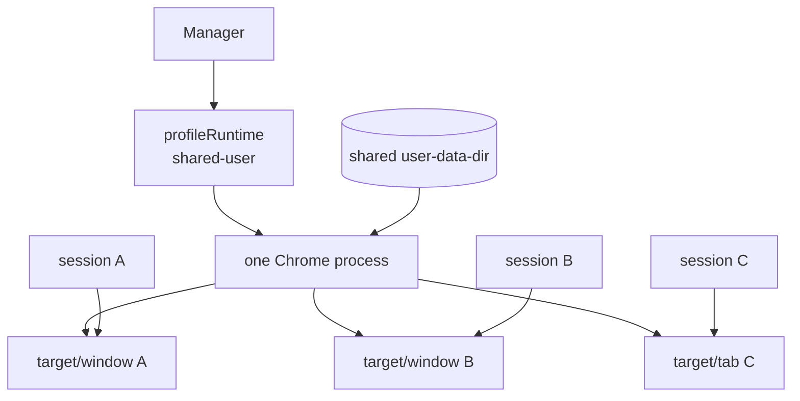

# 共享 profile 多 session 独立窗口设计（YHX-TODO-805）

- 日期：2026-11-03
- 状态：已集成到 `shared-profile-multiwindow` 分支并通过隔离测试；待合 master/重启 8321
- 分支：`shared-profile-multiwindow`
- worktree：`/home/soar/Projects/cc-webui-shared-multiwindow`
- 基于：master `ca2d2bc`
- PoC：`cmd/shared-profile-poc/main.go`

## 结论

目标可行。用一个 Chrome 进程持有 shared profile，每个 AgentDeck session 对应一个 CDP target/window；所有 target 在同一个默认 browser context 里，cookie 和 localStorage 天然共享，不需要同步 profile 文件。

推荐方案 A：单 Chrome 进程 + 多 target/window + session→target 映射。最小 PoC 已在本机 headless Chrome 136 上验证：`Target.createTarget(..., NewWindow: true)` 和 `NewWindow: false` 都能创建 target；窗口 2 和 tab 能读到窗口 1 写的 cookie 和 localStorage。

## 当前限制

当前 manager 是 per-session 启动 Chrome，sharing 通过复用同一个 `user-data-dir` 实现。`Manager.getOrCreate` 用 `profileOwners[profile]` 记录持有者，第二个 session 拿到 `ErrProfileBusy`，所以共享模式退化成单浏览器锁。

Chrome 自身要求一个 user-data-dir 只被一个 Chrome 进程持有；这个限制绕不过。正确做法是让所有 session 共用一个 Chrome 进程，而不是复制 profile。

## PoC 结果

本机执行：

```bash
go run ./cmd/shared-profile-poc
```

输出：

```text
window1=02F0CEAAF386B43C5BED9819B6231D74 window2=DE5AD200D20EA146B7032E612352CF77 tab=113B07CD016FD33A8B101BF8493BC1F1
window2 sees cookie="shared_cookie=yes" localStorage="yes"
tab sees cookie="shared_cookie=yes" localStorage="yes"
page targets=4 (two windows + one tab + initial blank expected)
PASS: one Chrome profile, independent targets, shared cookie/localStorage
```

PoC 的核心调用：

```go
id, err := target.CreateTarget("about:blank").WithNewWindow(true).
    Do(cdp.WithExecutor(ctx, chromedp.FromContext(rootCtx).Browser))
targetCtx, cancel := chromedp.NewContext(rootCtx, chromedp.WithTargetID(id))
```

`NewWindow: true` 在 headless Chrome 136 上可用；`NewWindow: false` 创建 tab。两者共享同一个 profile 的 cookie/localStorage。PoC 只使用临时 user-data-dir，未读取或修改线上 shared-user profile。

## 方案对比

| 方案 | 做法 | cookie/storage 共享 | 独立窗口/tab | 主要问题 | 结论 |
|---|---|---|---|---|---|
| A. 单 Chrome + 多 target | 一个 shared profile 进程，session→target | 天然共享 | 是 | 需要一个 runtime 层管理 refcount/target | 推荐 |
| B. per-session profile + cookie 同步 | 每个 session 独立 profile，复制/同步 Cookie DB | 非实时，需处理 SQLite/WAL/加密 | 是 | Chrome 锁、加密密钥、localStorage LevelDB、写冲突 | 不推荐 |
| C. incognito context + cookie 注入 | 每 session 一个 BrowserContext，注入 cookie | 需手动同步，非天然 | 是 | 登录态更新不会自动传播；localStorage 也要注入 | 不推荐 |

### A 的运行时模型



- `profileRuntime` 持有 allocator、root context、browser、Chrome 进程、target refcount。
- `Session` 增加 `runtime`、`targetID`；现有的 `ctx/cancel` 改为 target context。
- 每个 session 的 SSE、`browser_*`、接管状态都绑定自己的 target；互不影响。
- `CloseSession` 只关自己的 target；refcount 归零时才关闭 Chrome 和 profile。
- `SetSharedProfile(false)` 关闭所有 runtime；切回 per-session 模式。

### 改动面

| 文件/区域 | 改动 |
|---|---|
| `internal/browser/manager.go` | 新增 `profileRuntime`/refcount；`getOrCreate` 分 shared/per-session 两条路径；`CloseSession`/`CloseAll`/`reap` 释放 target 或 runtime；`profileOwners` 在 shared 模式改为 runtime 计数 |
| `internal/browser/manager.go` 的 `Session` | 增加 `runtime`、`targetID`；`start` 拆成“启动独立 Chrome”和“附着共享 target” |
| `internal/browser/actions.go` | 无需改业务动作；`runAction` 继续用 session 的 target context |
| `internal/server/browser.go` | 可选：`SessionStatus` 增加 target/window 标识；SSE 不变 |
| `internal/config/config.go` | 新增 `max_windows`（或复用 `max_browsers` 作为 shared 模式的窗口上限） |
| `web/browser.js` | 基本不变；面板按当前 session 的 SSE 显示自己的 target |
| 测试 | runtime 生命周期、target 关闭、refcount、两 session cookie 共享、最后一个 session 关闭浏览器 |

### 窗口还是 tab

- `NewWindow: true`：每个 session 一个 Chrome window，符合用户说的“独立窗口”；headless 下没有可见 OS 窗口，但 panel/SSE 仍按 target 区分。
- `NewWindow: false`：一个窗口多 tab，资源更省；用户说“就和多 tab 一样”，语义上也满足。
- 建议配置 `browser.shared_window_mode: window|tab`，默认 `window`；headless 下两者 cookie/storage 行为一致。
- 如果要看到完整 Chrome UI（tab 栏/地址栏/扩展按钮），需要 803 的 Xvfb + headful Chrome；target 模型不变，只是画面来源换成整窗捕获。

### 生命周期与清理

- 第一个 shared session：启动 Chrome，使用 root target 或创建第一个 window。
- 后续 session：`Target.createTarget("about:blank").WithNewWindow(true)`，`chromedp.NewContext(root, WithTargetID(id))` 附着。
- session 关闭：`Target.closeTarget(id)`，取消 target context，refcount--。
- 最后一个 session 关闭/空闲：关闭 Chrome，释放 profile 锁，删除 runtime。
- 用户手动关闭窗口：监听 `Target.targetDestroyed`/`Target.detachedFromTarget`，把对应 session 标记为关闭，避免僵尸映射。
- `browser_close` 只关当前 target；`browser_restart` 在 shared 模式下应改为“关掉并重建当前 target”，不能重启整个 Chrome（会打断其他 session）。

### 并发与隔离

- 一个 Chrome 进程、多个 renderer；单个 target 崩溃通常只影响该页面，浏览器进程崩溃会影响所有 session。
- shared profile 下 cookie/localStorage 是共享的：一个 session 退出登录会立刻影响其他 session，这是用户想要的行为，也要在 UI/文档里写明。
- 不同用户不能共用 shared profile；同一用户的多个 session 可以。
- 现有 `max_browsers` 是 Chrome 数量；shared 模式应新增窗口上限，防止一个用户开几十个 target。
- 关闭一个 target 不会清理 shared profile；登录态保留，和现在 per-session profile 语义一致。

### 风险与未知

- `Target.createTarget(NewWindow:true)` 在旧 Chrome/某些平台可能不支持；PoC 在 Chrome 136 headless 通过，需要在目标版本上回归。
- `chromedp.WithTargetID` 的 cancel/close 语义要验证 target 不会泄漏；PoC 已验证创建/读共享数据，关闭路径只做了 `CloseTarget`。
- 扩展 background page 也会出现在 target 列表；映射时只认 `type=page`，不要误把扩展页当 session。
- `profileOwners` 改成 runtime 后，现有 `ErrProfileBusy` 的用户提示要改；shared 模式不再 busy，per-session 模式不受影响。
- `browser_restart`/`browser_close` 的语义变化需要同步工具描述和前端文案。
- 内存/CPU 随 target 增加；Chrome 本身共享，但每个 tab 有 renderer。
- 若同时使用 803 的整窗捕获，headful + Xvfb 下多窗口可见；headless 只适合 panel 按 target 观看。

## 推荐

1. 采用 A：单 Chrome 进程 + 多 target，shared 模式只保留一个 runtime；per-session 模式维持现状。
2. 第一步做 manager 内最小集成：`profileRuntime` + `Session.targetID` + target 关闭/refcount；先只支持 `NewWindow:true`，失败回退 `false`。
3. 第二步补 `max_windows`、`targetDestroyed` 处理、`browser_restart` 语义和测试。
4. 需要完整 Chrome UI 时再接 803 的 Xvfb 整窗捕获；两者可以组合。
5. 不建议 B/C：cookie 同步和非实时注入会带来加密/一致性问题，且用户要的就是“像多 tab 一样自然共享”。

## 人日估算

- 设计 + 最小 PoC：0.5–1 人日（已完成）。
- manager 集成（runtime、target 映射、关闭/refcount、SSE/接管回归）：3–5 人日。
- 配置/上限/手动关窗/工具语义与测试：1–2 人日。
- 合计约 4–7 人日；不含 803 的 Xvfb 整窗捕获。

## 集成实现（2026-11-03）

已按推荐 A 在分支实现：

- `Manager` 增加 `profileRuntime`/`runtimeStarts`，shared 模式按 profile 复用一个 Chrome；`refs` 随 session 增减，最后一个释放时关闭 Chrome。
- `Session` 增加 `runtime`/`targetID`；shared 模式用 `Target.createTarget(NewWindow:true)` 建窗口，失败回退 tab，再用 `chromedp.NewContext(root, WithTargetID)` 附着；target 首次附着必须用长生命周期 context，避免超时子 context 把 CDP session 一起取消。
- `CloseSession` 只关当前 target 并释放 ref；`CloseAll`/idle reaper 同样。
- shared 模式移除 `profileOwners` busy 检查；`max_windows` 限制窗口数（默认 4，1..8）。
- `browser_close`/`browser_restart` 改为窗口级语义；`targetDestroyed` 由浏览器事件监听异步清理 session，避免在 chromedp 事件循环里取消 target 造成死锁。
- 测试：`internal/browser/shared_profile_test.go`
  - `TestSharedProfileMultiTarget`：两个 session 共享 cookie/localStorage，关闭一个另一个仍可读，最后一个关闭后 runtime 归零。
  - `TestSharedProfileTargetDestroyed`：直接销毁 target 后 session 被清理、ref 递减。
- 隔离实例 18829（临时 profile）实测：两 session target 不同、SSE 都能出帧、take s1 后 s2 仍 agent、关闭 s1 后 s2 继续可读、最后关闭 running=0；per-session 模式另行验证 cookie 隔离、两个 Chrome、关闭一个不影响另一个。

## 未完成

- 未改 master、未部署、未重启 8321、未触碰线上 shared-user profile。
- 未验证旧版 Chrome、macOS/Windows；手动关窗路径已用 targetDestroyed 测试覆盖。
- 未做 `browser_restart` 在 shared 模式的专门回归（实现为关当前 target 后重建）。
